# kspilot: an autonomous launch-and-booster-return controller for Kerbal Space Program: system and development report

Howard Huang1 & Claude2

1Independent researcher, Adelaide, Australia. Corresponding author: howardhuang11@outlook.com.

2Claude (AI system developed by Anthropic).

---

*Version 2.3.*

**Abstract.** kspilot is an open flight-control system that flies a launch vehicle in the game Kerbal Space Program through the complete mission: ascent to a commanded orbit, payload release, deorbit-burn planning and a powered landing of the core stage on the launch pad. In a series of 28 development missions flown, 26 met the landing criterion fixed in the software (26 of 27 to 26 of 34 under other population definitions), with a median miss of 1.53 m. A 22-flight ablation and dispersion study showed that the airbrakes and the glide are essential: removing either crashed every flight (two each). A test flight with a 50 m injected offset landed 2.1 m from the pad. A docking extension flew a rendezvous hold 1 km from a station and the first power-on of its reaction-control thrusters. The software was written by an AI coding agent under human direction, and the work was run by a management system of sub-agents, review gates and a stop rule that this report also describes.

**Keywords:** Kerbal Space Program; propulsive landing; autonomous guidance; development report; reproducibility; AI-assisted engineering.

## 1. Introduction

### 1.1 Purpose, mission and status

kspilot is a flight-control system for the spaceflight game Kerbal Space Program (KSP). Through the kRPC interface it flies a launch vehicle to a commanded orbit, releases the payload, plans and flies the deorbit burn, and returns the core stage to a powered vertical landing on the launch pad. It uses no third-party autopilot code. All quantities in this report are game outputs.

Of the 28 development missions of Section 4, 26 landed within the landing criterion, with a median miss of 1.53 m. Table 1 lists the development results, each with its n. Terms from the project's records are defined in Appendix A.

**Table 1 | Development results**

| Result | n | Outcome | Section |
|---|---|---|---|
| Landing criterion met in the 28-mission window | 28 | 26 (26 of 27 to 26 of 34 under other population definitions) | 4.2, 4.3 |
| Miss of the successful landings | 26 | Median 1.53 m (range 1.22–2.27 m) | 4.3 |
| Terminal-phase regression gates | 14 sessions, 44 landings | All sessions passed; median miss 3.67 m | 4.5 |
| Divert test flight with a 50 m injected offset | 1 | Touched down 2.1 m from the pad | 4.7 |
| Large-offset landing burns of the flown law, lit 110–670 m from the target | 8 | Closed 19–111 m of the offset; landed 81–651 m from the pad | 4.7 |
| Ablation and dispersion study | 22 flights | Removing the airbrakes or the glide crashed every flight (two each) | 4.8 |
| Docking extension | single flights | Rendezvous hold 1 km from a station; first power-on of its reaction-control thrusters | 4.9 |
| Incidents | 8 | Each investigated (Table 6) | 4.10 |

The landing criterion is landed, miss < 20 m, touchdown speed < 4 m s−1, upright.

### 1.2 Related work

Propulsive landing of orbital-class boosters has been demonstrated repeatedly in recent years1. Its terminal phase rests on convex optimization. Lossless convexification turns the nonconvex thrust constraints into a second-order cone program that can be solved to global optimality onboard2,3, minimum-landing-error formulations handle unreachable targets4, successive convexification extends the approach to six-degree-of-freedom models5,6, and customized interior-point solvers have flown on test vehicles7. Convex-optimization descent guidance for reusable launchers has been evaluated in closed loop over full recovery scenarios8. Earlier phases draw on entry guidance, in which range is controlled by modulating the aerodynamic force through bank angle9, numerical predictor–correctors10 or discrete drag-area changes11. A complete return couples all of these, with a propellant reserve that every phase depletes.

KSP12 simulates vehicles assembled from parts on a rotating planet with part-based aerodynamics, and the kRPC interface13 lets an external program read the state and command the controls. KSP has supported research on orbital pursuit–evasion games14 and language-model spacecraft operators15. Community tools automate parts of booster return. MechJeb2 provides ascent and landing autopilots16. BoosterGuidance flies boostback, re-entry burn, aerodynamic descent and landing burn to a chosen target from a suborbital trajectory, with the ascent flown by the player17. kOS-RTLS-Landing flies the boostback and landing of a booster18.

None of these tools flies the orbital mission with payload release, deorbit planning and pad landing as one autonomous sequence, meaning one program that runs all phases without the player (GitHub and KSP forum searches). This report contributes an open system that flies the complete mission, with a record of how it was built and tested.

### 1.3 Organisation

Section 2 describes the system and its test infrastructure, Section 3 the methods as flown, and Section 4 the development flights in the order they were made. Section 5 collects the design options that were evaluated in simulation only. Section 6 describes how the AI agents were managed, Section 7 discusses the results and limitations, Section 8 concludes and outlines further work, and Section 9 explains how to obtain and regenerate the work.

## 2. System description

### 2.1 Vehicle and environment

The game, KSP v.1.12.5 (ref. 12), runs the kRPC v.0.6.0 server13 and AutoLab, a C# plugin written for this work that loads a dedicated save, dismisses dialogs and takes screenshots. The guidance code does not need AutoLab, but unattended operation does, because the watchdog keeps its input lock alive. The flight software, the Python package `kspilot`, runs in a separate process and talks to the game only through kRPC. It reads states and commands throttle, attitude targets (through the kRPC autopilot), staging, action groups and time warp.

All analysed missions use the T-WorksFineGF family, built from a community design19 with grid fins from the Kerbal Reusability Expansion20. It has four solid boosters around a liquid-fuelled core with one engine, eight airbrakes, four grid fins, four legs and a 1,000-unit battery. The baseline vehicle has a lift-off mass of 92.7 t (53.1 t after booster separation; core dry mass 11.4 t) and a 2.48 t payload. Ballast variants carry 4.50 and 6.00 t, and a lamp variant adds eight lamps (Supplementary Fig. 4). Propellant is reported in kg of liquid fuel plus oxidizer, 11.11 kg per remaining game unit of liquid fuel. Electric charge is a dimensionless game unit, reported as a fraction of the 1,000-unit core battery. Kerbin has a radius of 600 km and an atmosphere about 70 km deep. Navigation is not modelled, so the guidance reads exact states.

### 2.2 Software architecture and mission phases

The mission is a fixed sequence of phases. Table 2 lists each phase with the module that implements it and its principal parameters, and Fig. 1 shows a mission profile, the vehicle and the software architecture.

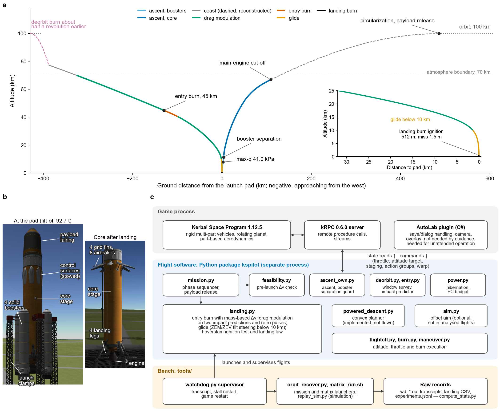

**Fig. 1 | Mission profile, vehicle and software.** a, Mission 1 (miss 1.5 m), coloured by phase. b, Game images of the vehicle at the pad and of the recovered core. c, Software architecture.

In mission 1 (Fig. 1a) the ascent flew east to main-engine cut-off at 66.8 km. Maximum dynamic pressure of 41.0 kPa came 42 s after lift-off, and the boosters separated at 52 s. After the coast to the 100 km apoapsis the stage approached the pad from the west. It coasted above 70 km, modulated drag with the airbrakes, burned the entry engine from 44.9 to 40.4 km (the first commanded thrust segment of at least 3 s), glided below 10 km and lit the landing burn at 512 m.

The ascent trace of panel a is integrated from the transcript telemetry (surface speed and altitude every 2 s) up to cut-off. The coast to apoapsis is a two-body reconstruction constrained to the apoapsis logged at cut-off. The orbit and the coast after the deorbit burn are schematic, and the return is the game-time descent telemetry from 77 km to touchdown. Panel b shows the lift-off vehicle (92.7 t, payload under a fairing) and the recovered core (26 parts: four grid fins, eight airbrakes, four landing legs, one engine). In panel c the flight software runs as a separate process, and a bench layer launches and supervises the flights and keeps the raw records from which every figure is regenerated.

**Table 2 | Mission phases, modules and principal parameters**

| Phase | Module | Function | Principal parameters (default) |
|---|---|---|---|
| Pre-launch check | `feasibility.py` | Stage-wise Δv budget for ascent and recovery; refuses launch if not met | Recovery margin factor 1.08 |
| Ascent | `ascent_own.py`, `ascent.py` | Vertical rise, pitch-over, gravity turn, closed-loop apoapsis targeting, circularization, trims | Azimuth from target inclination |
| Booster separation | `ascent_own.py` | Holds release of spent boosters; logs part count against expectation; aborts on further part loss or thrust collapse | q ≤ 10 kPa (20 kPa before mission 13) |
| Payload release | `mission.py`, `vehicle.py` | Stages the payload | – |
| Deorbit planning | `deorbit.py`, `entry.py` | Window survey; finite-burn targeting by impact prediction | Normal Δv ≤ 30 m s−1; 12 revolutions |
| Power management | `power.py`, `mission.py` | Hibernation and electric-charge budget on long coasts | Coast > 2 h; ≥ 30% charge at touchdown |
| Vacuum corrections | `mission.py` | Up to six trims above 71 km on the airbrakes-deployed prediction | Aim 1,500 m short; tolerance 300 m; ≤ 15 m s−1 per trim; gain 0.6 with secant update |
| Entry burn | `landing.py` | Retrograde burn with cross-track tilt; mass-based Δv count; vernier | About 45 km; 590 m s−1; tilt ≤ 3° |
| Range control | `landing.py` | Airbrake drag modulation on two predictions; routine retro pulses; airbrakes forced out above 10 kPa | 1 Hz; 0.5 s pulses when long by > 150 m above 6 km; 2× physics warp above 25 km |
| Glide | `landing.py` | Body-tilt aerodynamic steering, zero-effort miss and velocity to 450 m | Below 10 km; tilt ≤ 8°; time-to-go floor 15 s |
| Landing burn | `landing.py` | Stop-height ignition test; continuous landing law | Test throttle 0.65; gate 4 m; commit 25 m above the gate; lateral funnel min(3 m s−1, 0.2*h*) |
| Supervision | `landing.py`, `tools/watchdog.py` | Dead-man throttle cut; restart of a stalled process or game | Heartbeat age 2.5 s |

q, dynamic pressure; Δv, velocity increment. Values are defaults of the released code. A text test (`tests/test_paper_parameters.py`) confirms that most quoted literals appear in the source. The optional offset-aim mode, unused in the analysed flights, is described in Supplementary Note 4.

### 2.3 Test and supervision infrastructure

Every flight in this report went through the same infrastructure. The watchdog (`tools/watchdog.py`) supervises each run, writes a transcript, which is the run's text log, and restarts a stalled process or an unreachable game. Inside the flight software a dead-man switch cuts the throttle when the loop heartbeat is older than 2.5 s of wall-clock time (Section 3.4). A checkpoint is a saved game state recorded during an earlier flight, so that a later phase can be flown repeatedly without the phases before it. The development used checkpoints in orbit, before the entry burn, about 4 km above the pad and, for the divert test flights, 15 km above the pad (the saved state loads at 14.5 km).

The records are the supervisor transcripts, whose outcome line classifies each run, and one experiment-log record per flight that reached descent, which holds the miss at 0.01 m and the code revision. Landing telemetry is logged at about 15–25 Hz of game time, and the robustness-matrix log completes the set. Records are joined by the name of the per-flight log, and every source is filtered on the start time of its run.

Development followed a staged process adapted from systems-engineering review practice21. Offline tests ran against a simulated kRPC connection, including a text test that the defaults quoted in this report appear in the code. Replay simulators were identified from logged flights. A regression gate of three landings from a checkpoint about 4 km above the pad passes when at least two land within 5 m and all three meet the landing criterion. Phase-specific gates ran from a pre-entry checkpoint after changes to earlier phases, and a new configuration could not skip an envelope stage. After any crash or unexplained miss the vehicle was grounded until a root cause, a corrective action and a verification flight existed.

The control loop is timed by the wall clock, with a 0.04 s sleep plus a remote-call latency of 0.021 s at the 95th percentile, measured in a 60 s read-only check of the chaser vessel outside any landing. It is not synchronized to physics frames (Supplementary Fig. 2). Landing-burn telemetry rows were spaced by a median of 0.06 s of game time, with a per-mission maximum of 0.06–0.28 s.

## 3. Methods as flown

The subsections follow the order of flight. Parameter values are defaults of the released code (Table 2).

### 3.1 Ascent and booster separation

The ascent flies a vertical rise, a pitch-over towards the launch azimuth and a zero-angle-of-attack gravity turn. Above 70% of the atmosphere height, pitch is controlled on apoapsis and time to apoapsis. Circularization and trim burns point along the remaining Δv vector. When a staging event only discards spent boosters, release is held until dynamic pressure is below 10 kPa (20 kPa before mission 13). After separation the part count is compared with the count expected from the staging tree, and a mismatch is logged. The ascent aborts if parts are lost after the first post-staging sample, if thrust stays below 50% of the pre-staging thrust for 0.5 s within 5 s of staging, or if thrust stays below 10% of the available thrust for 2 s. A separation that removed legs, fins or airbrakes with thrust intact would go undetected until descent.

### 3.2 Deorbit planning and power management

An impact predictor integrates the equations of motion with central gravity, a co-rotating atmosphere and tabulated drag, using an adaptive Dormand–Prince 5(4) integrator22 with Hermite event location. The deorbit burn is modelled as a finite burn at fixed inertial attitude, and its retrograde and normal components are solved so that the predicted impact falls on the target. Windows one revolution apart are surveyed over up to 12 revolutions. The first window whose normal component is at most 30 m s−1 and that passes optional tests is taken, and otherwise the cheapest. On coasts longer than 2 h the probe core hibernates during time warp with the reaction wheels off. A window is eligible only if a budget at a conservative 0.01 units s−1 predicts at least 30% charge at touchdown.

### 3.3 Vacuum mid-course corrections

After the deorbit burn and above 71 km, up to six trims correct the predicted impact point (`Mission.coast_and_correct`). Each uses the median of three predictions with the airbrakes-deployed drag table and aims 1,500 m short of the pad, which places the stage inside the drag-modulation bracket. A trim is flown only if the predicted error exceeds 300 m and the trim lies between 0.02 and 15 m s−1.

Its size is the predicted correction times a gain that starts at 0.6 and is updated by a secant rule (previous gain over the observed-to-predicted effect ratio, times 0.9). After a deorbit error of about 3.4–4.1 km (10–12 km in four missions disturbed by frame capture), a median of four trims (range 4–6; median total 1.11 m s−1) reduced the predicted miss to 161–364 m. The observed effect was 1.01 times the predicted effect (range 0.93–1.12; 112 trims), so the falling gain follows from the 0.9 factor and the predictor shows no bias.

### 3.4 Entry burn and velocity-increment accounting

The core fires retrograde near 45 km at a dynamic pressure of about 1 kPa for a planned 590 m s−1. It tilts the thrust sideways by up to 3° once per second to null the predicted cross-track miss, and a small sideways vernier follows. Since mission 22 the Δv of each tick is *I*sp*g*0 ln(*m*prev/*m*), with *I*sp read at ignition and a cap of 1.25 times the full-thrust Δv of the tick plus 0.5 m s−1. Without the cap the sum telescopes to *I*sp*g*0 ln(*m*0/*m*) whatever the tick timing, and a capped tick breaks this and makes the burn over-fly. The vessel mass includes every consumable, and during the burn only main-engine propellant is consumed (the reaction-control thrusters are off and there is no ablator).

On the deciding tick the vernier is planned before the throttle command is sent, which delays the cutoff by 0.24–0.48 s. A fix that sends the command first is implemented and not yet flown. The dead-man switch cuts the throttle when the loop heartbeat is older than 2.5 s of wall-clock time. The logged stall duration is the heartbeat age re-read after the throttle command completes, so some events log 0.1 s because the loop had resumed during the command.

### 3.5 Drag-modulated descent

Once per second the predictor is run with the airbrakes-deployed and airbrakes-retracted drag tables, each scaled by a factor estimated online. The airbrakes are deployed if the deployed prediction is long, retracted if both are short, and otherwise retracted until the deployed prediction returns to the target. Above 10 kPa the airbrakes are forced out for structural safety, and modulation stops at the glide altitude of 10 km. While the deployed prediction is more than 150 m long above 6 km, 0.5 s retro pulses shorten the range, and every fifth pulse is logged.

The pulses are routine (median 8 thrust segments after the entry burn and 282 kg of propellant before landing-burn ignition) because the residual at 10 km is always long. Above 25 km the descent runs at 2× physics warp, which lengthens the physics step. Drag tables are measured per vehicle and corrected by calibration factors fitted to earlier flights of the same family.

### 3.6 Glide

Below 10 km the stage tilts by up to 8° so that the aerodynamic normal force steers the predicted ignition point to the target. Guidance is explicit23 zero-effort-miss and zero-effort-velocity feedback24,25 towards zero position and horizontal velocity at 450 m, with the time to go floored at 15 s. The drag decay of horizontal velocity assumed in the zero-effort-miss prediction (time constant |*v*|/*g*) is a heuristic.

### 3.7 Landing burn

On every control tick a stop-height test decides ignition. It integrates a constant-throttle (0.65) burn with command delay, engine spool-up and 35% of the tabulated drag to a stop 25 m above the gate, and checks that the horizontal offset can be nulled with 35% of the tilted thrust after a 3 s attitude dead time. One continuous law then flies to touchdown. The vertical channel follows a constant-deceleration profile to 1.5 m s−1 at a gate 4 m above the pad.

Above a commit height 25 m above the gate (about 29 m above the pad) the lateral channel commands a horizontal velocity towards the target, capped by the available lateral acceleration. A variant that caps it so that it can be nulled before the commit height is disabled. Below the commit height only lateral velocity is damped, within min(3 m s−1, 0.2*h*). The released code also contains a convex planner, which is used offline only (Section 5.3).

## 4. Development flights

### 4.1 Measurement conventions and populations

Miss is the horizontal distance of the vessel's centre of mass from the target after a 3 s hold and 10 s of settling, both wall-clock waits. The logged touchdown speed is read after the landing loop exits, and the vertical speed and signed position at first contact come from the telemetry. The mission-12 times are measured from the start of the ascent, about 13 s after the transcript starts. Entry-burn Δv from mass uses *I*sp 320 s, which the engine's pressure curve gives at 39–45 km, and the settled mass after engine shut-down.

Medians have distribution-free order-statistic intervals, which are not reported for n < 10. Proportions have Wilson26, Clopper–Pearson27 and Jeffreys28 intervals. Figures use Matplotlib29. The numbers regenerate from the raw records (Section 9), with the exception of the 0.17 m booster–core gap and the explosion counts from overwritten game logs, which come from the project's decision record.

A transcript belongs to the development window if it flew the own-code ascent to a commanded orbit with a T-WorksFineGF-family vehicle from the pad and the data freeze. The window opens at the first mission flown with the recalibrated drag model (Section 4.2), which followed two failed complete missions; the recalibration was fitted to those failures. The 28 missions were identified with this definition after the flights, and the flight code changed within the window, so the series is a record of the system as it developed. Per-flight code revisions are in `paper/tables/campaign_flights.csv`.

### 4.2 Campaign chronology

The development record before the freeze holds 278 supervisor transcripts (Fig. 2; flow table in Appendix B). The first is dated. An earlier vehicle, T-WorksFinePayload, accounts for 81 of the 278, and 24 of those were successful. Before the window the T-WorksFineGF family had ten pad transcripts. Six failed, among them three ascent losses, a mission that missed by 599.5 m with earlier ascent code, and two complete missions that missed by 189 m and 1,192 m. Four recorded no outcome, one of them a deorbit-planner crash.

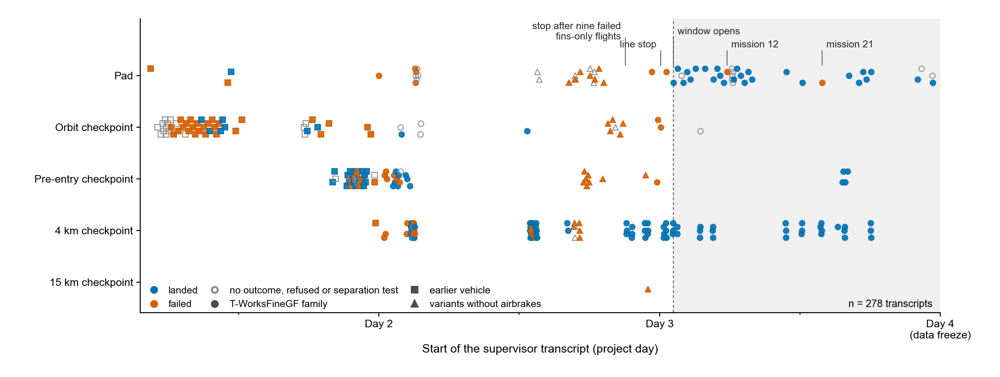

**Fig. 2 | Development transcripts before the data freeze (n = 278).** Start state, outcome and vehicle of each; shading marks the development window.

Variants without airbrakes (fins only) were flown before the window, and none of their 36 transcripts succeeded. The line stopped after nine consecutive failures, each following a single changed guess. The project returned to the proven airbrake vehicle and adopted the stop rule as a standing process rule. The line later stopped again after the second consecutive failure of a verification block, in which a flight ignited 173 m off target and toppled. The drag tables were about 7% low with a stale drag calibration, and an off-pad thrust-cut rule caused the topples. Drag was recalibrated and the rule fixed, and the first mission with the recalibrated model flew. That mission opens the development window.

The window contains 36 pad transcripts of the T-WorksFineGF family: 28 complete missions, 5 separation-only tests, 1 run that an external monitor terminated during the deorbit-node warp, and 2 attempts that never launched (one refused because video recording could not start, one stopped by a lost connection to the game). The 28 missions are numbered chronologically. Eight carried a video-recording workload, and nine were robustness-matrix attempts, five of them with a raised deorbit-window threshold (60, 100 or 130 m s−1 against a default of 30).

Of the 28 missions, 26 met the landing criterion present in the software at export: landed, miss < 20 m, touchdown speed < 4 m s−1, upright. The 20 m limit is in `tools/orbit_recover.py` and was fixed before the flights (decision record). All 26 also landed within 5.00 m. The proportion depends on the population definition. It is 26 of 27 for the return phase conditional on reaching orbit and 26 of 34 for every complete own-code-ascent pad mission of the family, with the terminated run counted as a failure (Fig. 3).

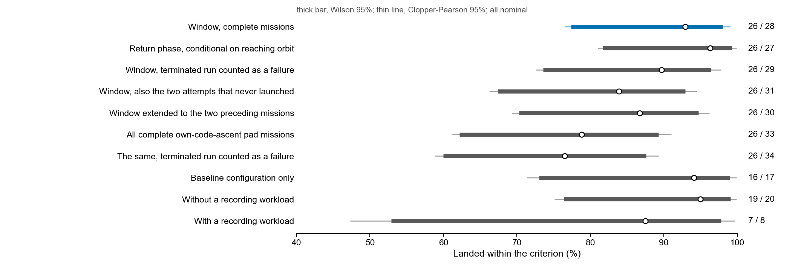

**Fig. 3 | Missions meeting the landing criterion under ten population definitions.** Wilson (thick) and Clopper–Pearson (thin) 95% intervals. Data in Table B2.

### 4.3 The 28-mission series: landing accuracy

The median miss of the 26 successful landings was 1.53 m (range 1.22–2.27 m; Table 3). Fig. 4 shows the complete missions. Ascents are drawn for the 23 missions without in-game frame capture, because frame capture slows the game against the wall clock that stamps the ascent telemetry. Mission 12 shows the loss of the core at booster separation. Returns are drawn for the 27 missions with descent telemetry, and mission 21 ended 3.8 km short. Peak dynamic pressure of the 26 successful returns was 17.5–22.5 kPa near 19 km and peak heating 0.49–0.65 of the limit, with entry burns at 39.2–44.9 km.

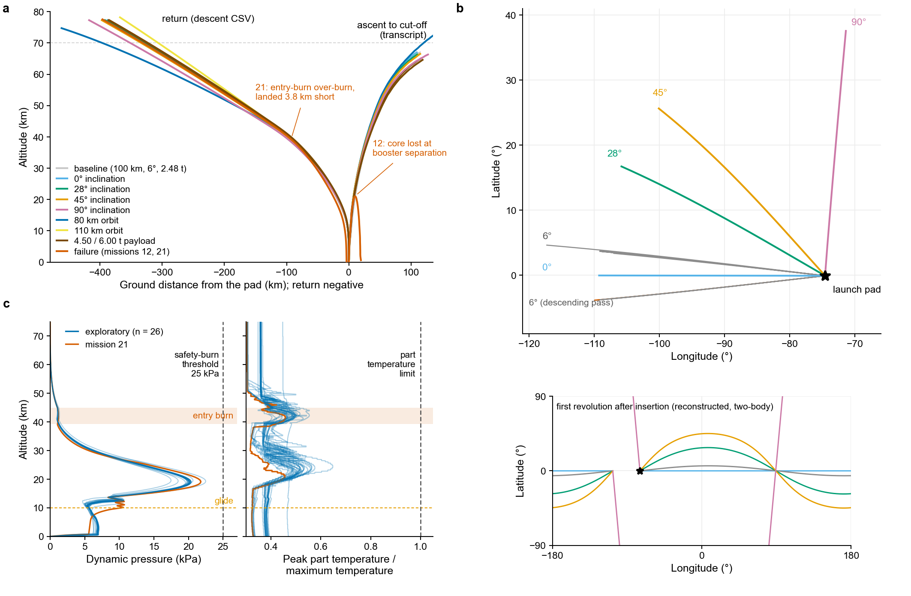

**Fig. 4 | Trajectories of the complete missions.** Altitude against ground distance for the 28 missions (a), descent ground tracks by inclination (b) and the entry corridor of the 26 successes and mission 21 (c).

The landings cluster 1.33 m from the target, on its west side: at first ground contact the mean contact point lay 1.33 m from the target, and the mean distance of the 26 contact points from the target is 1.50 m. All 26 contact points were west of the target, by 0.1 to 1.8 m with a median of 1.4 m, and one of them, at 0.1 m west, was also 2.2 m north. The median scatter about the mean contact point was 0.28 m. The miss is therefore mostly a fixed offset with little dispersion, which is why the interval on the median miss is narrow. The offset is systematic; the candidate sources are the target coordinate, the offset between the centre of mass and the reference point, and a terminal-guidance bias.

The same law gives other misses from other start states: 0.99 m from a state 15 km above the pad (Section 4.8) and 3.67 m from the 4 km checkpoint (Section 4.5). Host load was not recorded for the 28 missions. The burn ignited 0.4–2.2 m horizontally from the target at 0.0–0.3 m s−1 horizontal speed, so the landing law never had to divert. The logged touchdown speed (median 0.14 m s−1) is read after contact, and the vertical speed at first contact was 1.50–1.53 m s−1, the commanded final descent rate.

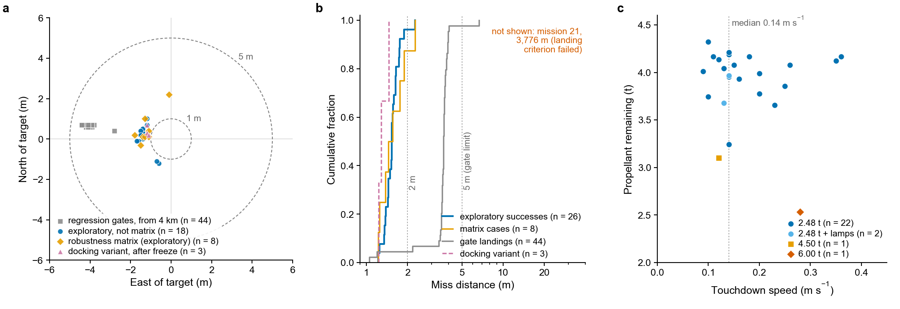

**Fig. 5 | Landing accuracy.** Touchdown positions (a), miss distribution (b) and touchdown speed against propellant remaining (c) for the development missions, matrix cases, gate landings and docking-variant landings.

Fig. 5a plots the touchdown position, from the last row of the descent telemetry, for 18 missions outside the robustness matrix, the 8 matrix cases, 44 regression-gate landings and 3 landings of a docking variant flown after the freeze. The development landings share a westward offset (mean east −1.31 m, north +0.23 m; n = 26). In Fig. 5b the successful missions have a median miss of 1.53 m (interquartile range 1.44–1.64 m), and mission 21 (3,776 m) lies off the axis. The gate landings have a median of 3.67 m, with 43 of 44 within the 5 m gate limit. In Fig. 5c the median touchdown speed is 0.14 m s−1 (interquartile range 0.12–0.20 m s−1) and the median propellant remaining is 4.0 t (interquartile range 3.8–4.2 t) for the 26 successful missions.

**Table 3 | Summary statistics of the development window**

| Quantity | Population | n | Median (95% CI) | IQR | Range | Mean ± s.d. |
|---|---|---|---|---|---|---|
| Horizontal miss (m) | Successful missions | 26 | 1.53 (1.45–1.63) | 1.44–1.64 | 1.22–2.27 | 1.56 ± 0.21 |
| Horizontal miss (m) | Successful baseline missions | 16 | 1.53 (1.44–1.64) | 1.45–1.63 | 1.35–1.74 | 1.54 ± 0.12 |
| East position at first contact (m) | Successful missions | 26 | −1.40 (−1.50 to −1.30) | −1.50 to −1.23 | −1.80 to −0.10 | −1.31 ± 0.36 |
| North position at first contact (m) | Successful missions | 26 | 0.20 (0.10–0.40) | 0.03–0.40 | −1.20 to 2.20 | 0.23 ± 0.64 |
| Distance from the mean contact point (m) | Successful missions | 26 | 0.28 (0.19–0.49) | 0.19–0.51 | 0.12–2.31 | 0.50 ± 0.52 |
| Logged touchdown speed, after contact (m s−1) | Successful missions | 26 | 0.14 (0.13–0.20) | 0.12–0.20 | 0.09–0.36 | 0.17 ± 0.07 |
| Vertical speed at first contact (m s−1) | Successful missions | 26 | 1.51 (1.51–1.52) | 1.51–1.52 | 1.50–1.53 | 1.51 ± 0.01 |
| Propellant remaining (kg) | Successful missions | 26 | 4,000 (3,856–4,133) | 3,797–4,158 | 2,533–4,322 | 3,895 ± 398 |
| Landing-burn ignition height (m) | Successful missions | 26 | 510 (498–516) | 496–516 | 389–953 | 550 ± 151 |
| Horizontal offset at ignition (m) | Successful missions | 26 | 1.1 (0.9–1.6) | 0.8–1.7 | 0.4–2.2 | 1.2 ± 0.5 |
| Horizontal speed at ignition (m s−1) | Successful missions | 26 | 0.2 (0.1–0.2) | 0.1–0.2 | 0.0–0.3 | 0.2 ± 0.1 |
| Coast propellant after the entry burn (kg) | Successful missions | 26 | 282 (261–310) | 253–311 | 184–366 | 279 ± 43 |
| Apoapsis error, absolute (m) | Missions reaching orbit | 27 | 18 (9–42) | 8–43 | 1–175 | 35 ± 44 |
| Periapsis error, signed (m) | Missions reaching orbit | 27 | −47 (−53 to −42) | −54 to −42 | −151 to +12 | −54 ± 36 |
| Inclination error, absolute (°) | Missions reaching orbit | 27 | 0.051 (0.036–0.080) | 0.033–0.097 | 0.003–0.356 | 0.086 ± 0.094 |
| Deorbit burn Δv (m s−1) | Missions reaching orbit | 27 | 158 (151–158) | 151–158 | 150–180 | 157 ± 6 |
| Planned wait to deorbit burn (h) | Missions reaching orbit | 27 | 2.7 (2.4–2.8) | 1.9–4.1 | 0.27–5.8 | 3.0 ± 1.7 |
| Dynamic pressure at separation (kPa) | Missions logging it | 16 | 9.7 (9.6–9.8) | 9.6–9.8 | 9.4–9.9 | 9.7 ± 0.2 |
| Entry-burn propellant (kg) | Missions 22–28 | 7 | 3,496 | 3,496–3,498 | 3,492–3,505 | 3,497 ± 4 |

Miss is from the experiment log (0.01 m); with the transcript values (0.1 m) the median is 1.5 m (95% CI 1.4–1.6 m). Contact position, speeds at contact and ignition, and coast propellant are from the landing telemetry. Per-flight values with code revisions are in `paper/tables/campaign_flights.csv`.

Periapsis errors were negative in 25 of 27 missions, the signature of a circularization burn that ends early. In five missions, all with frame capture active during ascent, circularization left errors of 3.9–5.1 km that trim burns reduced to at most 175 m.

### 4.4 Two failed missions

Mission 12 lost the core when a discarded booster struck it at separation, about 51 s after lift-off, and the ascent aborted only on reaching the surface. The decision record attributes the collision to separation at about 20 kPa, on the strength of a 0.17 m booster–core gap. The mission's own dynamic pressure was not recorded. Two separation-only tests at 18.8 and 19.1 kPa gave no core hit and four booster-side explosions at 19.1 kPa (Fig. 6c). The separation limit was lowered from 20 to 10 kPa and an abort on thrust collapse was added. Booster-side explosions continued in 4 of 8 later missions that measured them, none reaching the core (Supplementary Fig. 1), and the abort path has not been exercised.

Mission 21 flew while in-game frame capture slowed the control loop (Supplementary Fig. 2). A dead-man switch cut the throttle during five loop stalls in the entry burn, and ticks whose thrust sample then read zero went uncounted. The burn delivered 743 m s−1 from the logged mass for 608 m s−1 counted against a 590 m s−1 plan, and the stage landed upright 3.8 km short. Mission 20 had shown two such stalls in its entry burn and still landed. The Δv count was changed to use measured mass. The seven later missions (22–28) passed; none ran under frame capture, the condition of the stalls (missions 18–21 did) (Supplementary Note 1).

The uncounted ticks were the proximate cause of mission 21. The open-loop termination of the entry burn turns any counting error into range error (Section 5.2).

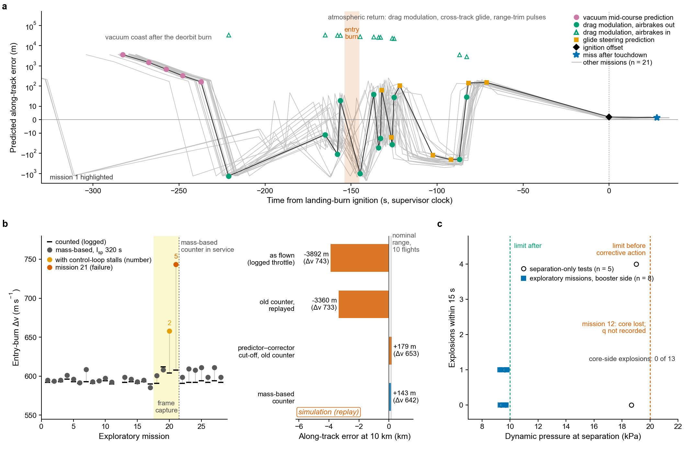

**Fig. 6 | Guidance internals and the two mishaps.** Predicted impact error by guidance stage (a), entry-burn Δv counted and from mass with a replay of mission 21 (b), and explosions near booster separation against dynamic pressure (c).

Fig. 6a shows the predicted along-track impact error from the transcript lines of each guidance stage, against supervisor-clock time from ignition, for mission 1 and 21 further successful missions without frame capture (n = 22). Drag modulation keeps the target bracketed between the airbrakes-deployed and airbrakes-retracted predictions until the glide. In Fig. 6b the logged Δv is compared with the Δv from the logged mass by the rocket equation (specific impulse 320 s, settled mass after shut-down) for the 27 missions with descent telemetry. Without stalls the two differ by −5 to +18 m s−1, mostly cut-off latency. Missions 20 and 21, under frame capture, delivered 658 and 743 m s−1 for 604 and 608 m s−1 counted (3,844 and 4,284 kg of propellant). The right part of panel b is the replay of mission 21 discussed in Section 5.2.

Fig. 6c plots explosions within 15 s of booster separation against dynamic pressure for five separation-only tests and eight development missions that logged that window. No core-side explosion occurred in any of the 13. Dashed lines mark the separation limits before (20 kPa) and after (10 kPa) the corrective action, and mission 12's separation dynamic pressure was not recorded.

### 4.5 Terminal-phase regression gates

All 14 gate sessions before the freeze passed, with 43 of 44 landings within 5 m and a median miss of 3.67 m (interquartile range 3.58–3.77 m; range 1.05–6.69 m; Fig. 7). Three landings made a session, and two single non-gate checks completed the 44. The cluster at 1.0–2.2 m coincided with heavy parallel computation on the host computer, under which the gate misses fell from about 3.7 m to 1.05–2.18 m. Every gate landing starts from one saved state, so the spread measures software repeatability.

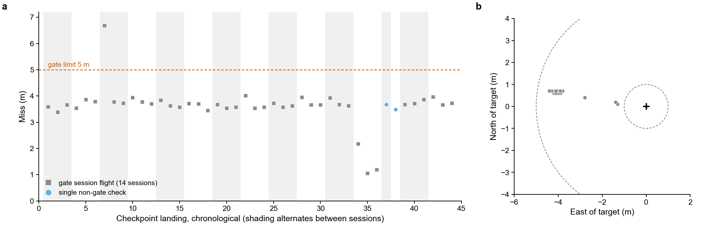

**Fig. 7 | Terminal-phase regression-gate landings.** Miss of the 44 landings in chronological order (a) and their touchdown positions (b). Dashed lines mark the 5 m limit.

The baseline miss is 3.6–3.7 m against a 5 m threshold, a margin of about 35%. The gate exercises the last 4 km of the descent, and the two failures of Section 4.4 arose in earlier phases.

### 4.6 Robustness matrix and long coasts

A one-factor matrix over inclinations of 0–90°, 80–110 km orbits and 2.48–6.00 t payloads passed all eight cases in nine attempts (Fig. 8). The 45° case was flown twice, because the first attempt was lost on ascent, and every other case once. Four of the eight cases (28°, 80 km, 45° and 90°) were flown with a raised deorbit-window threshold (`KSP_MAX_DVN` of 60, 60, 100 and 130 m s−1 against a default of 30), covering five of the nine attempts. The 80 km case needed a normal Δv of 46 m s−1, above the default limit.

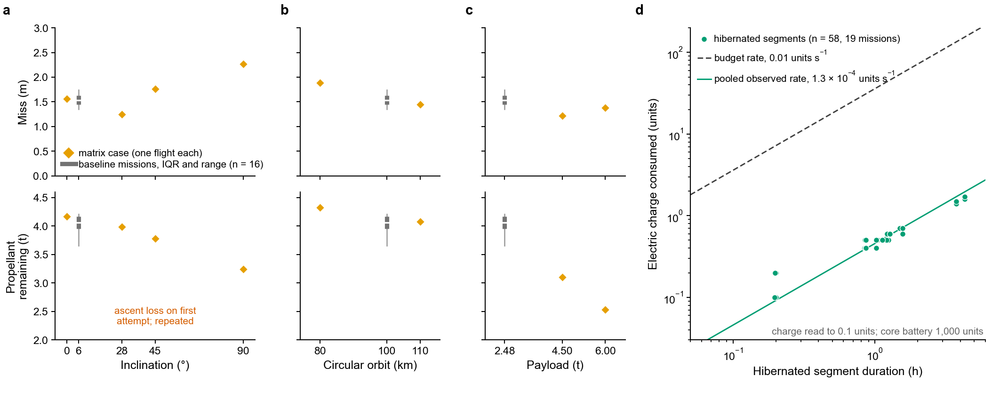

**Fig. 8 | Robustness across orbits and payloads, and electric power on long coasts.** Miss and propellant remaining of the eight matrix cases against inclination, altitude and payload (a–c), and charge used on hibernated coasts (d).

All eight cases landed within 2.3 m, and the largest miss was on the polar orbit (Fig. 8a–c, one flight per diamond, with the 16 baseline missions as grey bars). Propellant remaining fell with inclination (4.2 t at 0°, 3.2 t at 90°) and with payload (3.1 t at 4.50 t, 2.5 t at 6.00 t). Each case was flown once.

On coasts of up to 5.8 h, hibernation kept the core's electric-charge use to 3.1% of one battery in total across 19 missions, after a development flight had lost attitude control when the battery ran flat (Fig. 8d). The 58 hibernated segments (deorbit-window, node and entry-interface coasts) lasted 245,138 s in total and used 31.1 units, a pooled rate of 1.3 × 10−4 units s−1 that is about 1.3% of the 0.01 units s−1 rate assumed by the window budget. Charge is read to 0.1 units, which quantizes the short segments.

### 4.7 Landing-burn divert record and law E

The development missions never needed divert, because the glide delivered the stage within 2.2 m of the target at ignition (Table 3). Divert was measured in the flight record (Table 4). A test flight from 15 km with a 50 m injected offset landed 2.1 m from the pad, and 46 of 47 gate landings from offsets of 36–54 m ended within 5 m. Eight development burns of the flown law, lit for other reasons 110–670 m from the target at 13.2–13.9 t and 16.7–17.0 t, closed 19–111 m of the offset by touchdown and landed 81–651 m from the pad. Four test flights were made after the freeze.

The eight burns were flown on seven code revisions, none of them the final code, and three were test variants of the glide or roll damping with the same landing-burn code. Seven of the eight ended not upright (axis cosine from −1.0 to +0.32; 6–25 of 26 parts left, one touchdown at 18 m s−1), and two were toppled by an off-pad thrust-cut rule that was fixed later. They were lit 0.9–2.1 km above the pad, against about 0.5 km for the nominal burn. Five of the eight show 0 kg of propellant in the post-settle record, which is an artefact of the loss of the tanks in break-up. The last logged mass of those five exceeds the 11.37 t dry mass of the divert flights by 0.6–3.9 t (checked from the landing telemetry; the dry mass is inferred from divert flights 0 and 1).

The landing law also ran with a software limit on the gimbal command (`gimbal_limit = 0.5` in `kspilot/landing.py`) and with the grid fins and airbrakes released in the burn. These software settings, not the vehicle, set the low achieved tilt. Commands of 9–19° produced 1–5° until the speed fell below about 50 m s−1 (Fig. 9), so most of the closure came late in the burn. The 19–111 m of closure is the law's performance with these settings in eight burns; the vehicle's own limit was not measured.

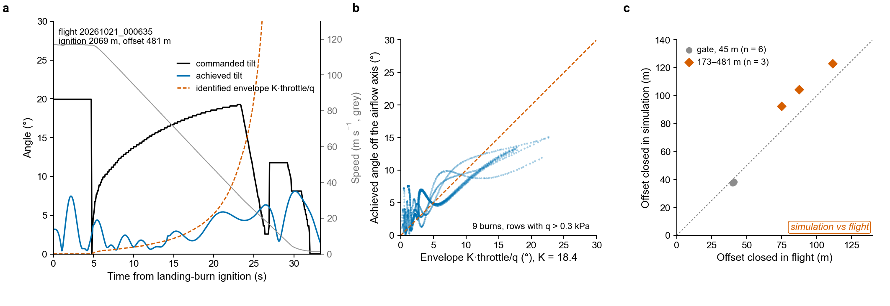

**Fig. 9 | Landing-burn attitude response.** Commanded and achieved tilt of one development burn (a), achieved angle against the identified envelope for nine burns (b), and a replay of the nine burns with the identified plant (c).

Fig. 9a shows a development flight ignited 481 m from the target at 2,069 m, with the authority envelope fitted by the identification model (K × throttle / dynamic pressure, K = 18.4° kPa). Fig. 9b uses the nine identification burns, in rows with dynamic pressure above 0.3 kPa. In Fig. 9c each burn is replayed with the identified plant (time constant 0.65 s, damping 0.86, slew 4.7° s−1, delay 0.25 s). The simulator is optimistic by 12–18 m for the three large offsets and pessimistic by about 3 m for the six gate burns. The commanded and achieved tilts of panel a are measurements. The envelope and panel c come from a plant that later failed validation (below).

The 4 km regression gate ignites 36–54 m from the pad. It ended with a post-settle miss within 5 m in 46 of 47 landings, the 44 before the freeze and the 3 of a gate session flown. In a test flight from a state 15 km above the pad, a decoy target held until ignition produced an offset of 50.0 m at ignition (50 m injected; first burn row of the telemetry). The flown law lit the burn at 832 m and touched down 2.1 m from the pad, upright (Fig. 10b,c).

The same flight tested the landing-burn replay simulator and contradicted it: the simulator had predicted ignition at or below 492 m and median misses of 8.7 and 20.1 m in its two plant forms. The flight triggered a line stop written beforehand ("simulator wrong"). The investigation traced the contradiction to a copy of the ignition rule that had drifted from the flight code, so that nominal comparisons still passed, and to a burn-phase normal force, taken from the glide, with the wrong sign. Two corrected versions failed acceptance criteria written before their validation runs, and the project dropped the simulator (Supplementary Note 5). No divert simulation is used in this report.

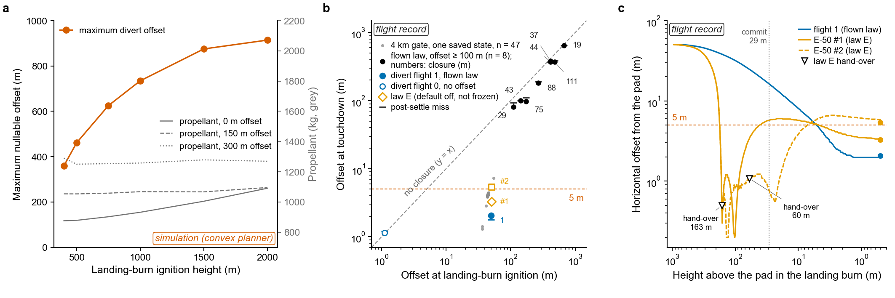

**Fig. 10 | Landing-burn divert: planner envelope (simulation) and flight record.** Maximum offset the convex planner can null (a), offset at touchdown against offset at ignition (b) and offset against height during three burns (c).

In Fig. 10b, black marks every development burn of the flown law lit 100–1,000 m from the pad (n = 8, with closure in metres) and grey the 47 gate landings. Blue marks the divert test flights from 15 km: flight 1 (flown law, 50 m injected offset; filled) and flight 0 (no offset; open). Orange marks law E, flights #1 and #2. Ticks show the miss recorded about 13 s after touchdown, which includes any tip-over.

No burn lit 100 m or more from the pad landed within 80 m of it. Fig. 10c shows the offset against height for flight 1 and the two law-E flights, with triangles at the hand-over from law E to the flown law (163 m and 60 m) and a dotted line at the commit height of 29 m, below which position is no longer chased. Panel a is the envelope of Section 5.3.

An alternative brake-then-translate law, law E, flew twice from the same saved state with an injected offset of 50 m. Against the two criteria written beforehand, flight #1 passed the mission criterion (a safe, upright landing within 5.00 m: 3.3 m at touchdown, 3.09 m after settling). It failed the law-intent criterion, because the law handed a hover to the flown law at 163 m, which then fell to 25.5 m s−1 at 88 m, braked a second time and drifted back out. Flight #2, after one change that delayed the hand-over to 60 m, passed the law-intent criterion (hand-over at 59.9 m, 1.1 m offset) and failed the mission criterion by 0.14 m (5.14 m after settling, against 5.00 m).

The decision record classed the two as the same kind of failure by root cause: a slow, high hand-over to the flown law, which drops to its throttle floor, loses attitude authority and drifts. Under an exit rule fixed before these flights, law E was dropped and the flown law was frozen. The flown law's own gate misses are 1.05–6.69 m after settling (47 landings, one above 5 m), so law E's 3.09 m and 5.14 m lie inside that range. The evidence for the flown law is one flight at 50 m (touchdown 2.1 m, 1.79 m after settling), against two law-E flights.

**Table 4 | Landing-burn flight record**

| Landing burns flown | n | Mass at ignition (t) | Offset at ignition (m) | Touchdown offset (m) | Closure (m) | Post-settle miss (m) |
|---|---|---|---|---|---|---|
| Flown law, development burns lit 100–1,000 m from the pad | 8 | 13.2–17.0 | 110–670 | 81–651 | 19–111 | 93–648 |
| Flown law, 4 km gate (one saved state), median (range) | 47 | 13.0 | 44 (36–54) | 4.2 (1.3–7.3) | 40 (35–47) | 3.68 (1.05–6.69) |
| Flown law, divert flight 1 (50 m injected) | 1 | 16.7 | 50.0 | 2.1 | 48.0 | 1.79 |
| Law E, divert flight #1 (50 m injected) | 1 | 16.6 | 50.3 | 3.3 | 47.0 | 3.09 |
| Law E, divert flight #2 (hand-over at 60 m) | 1 | 16.7 | 50.3 | 5.4 | 44.9 | 5.14 |

Vehicles that tipped or broke up after touchdown have a post-settle miss that differs from the touchdown offset. Records are in `paper/tables/divert_flight_record.csv`.

### 4.8 Ablation and dispersion

The ablation and dispersion study removed four guidance elements one at a time and applied two dispersions, in 22 flights, to show which elements the landing depends on. The switches are off by default, are in this repository's code tree, and tests with a fake connection show that the control sequence is bit-identical when they are unset. The plan, expectations and stop rules were written before the flights. Each flight ran through the watchdog with no retries, and the saved states were unchanged after every flight. The flights were made on revisions d6e5e86 and b9e4ebd, and the drag-bias arm straddles both.

Each arm flew two or three times (Fig. 11). The replicates of an arm start from one saved state, so their spread is game non-determinism. The arms flown from a saved state 15 km above the pad at mission mass had a baseline miss of 0.99 m (median of three).

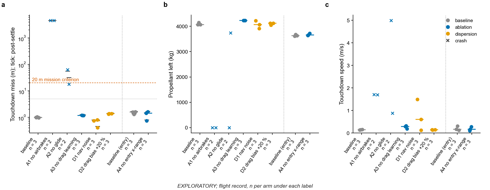

**Fig. 11 | Ablation and dispersion study.** Miss (a), propellant left (b) and touchdown speed (c) of each flight, by arm. Circles, upright landings; crosses, crashes; bars, medians of arms with three or more flights.

Without the airbrakes (arm A1), both flights overshot by about 4.6 km (4,570 and 4,605 m), lit the landing burn at 1 km at 163 m s−1, ran out of propellant and splashed down. The arm removes the airbrakes mid-descent from a state that was aimed with them. Without the glide below 10 km (A2), the ignition offset grew from 1.8 m to 62 and 102 m and both flights crashed. One tipped over after a touchdown 18 m from the pad (32 m after settling), and the other hit at 5.0 m s−1 and lost its tanks. These offsets exceed the 50 m that the landing burn closed in divert flight 1 (Fig. 10).

Fixing the in-flight drag scale at its nominal value (A3) changed the miss by +0.19 m and left 162 kg more propellant (three flights, spread ±4 kg). Navigation noise (D1; 5 m and 0.5 m s−1 per axis per tick) raised the median touchdown speed from 0.14 to 0.60 m s−1 (maximum 1.49 m s−1) without a larger miss (0.74 m) or a change in propellant use. The ignition offset of this arm (2.8–17.8 m) was read from the noisy navigation state. With a guidance drag model 20% too large (D2) the median miss was 0.38 m larger (1.37 m), above all three baseline flights.

The entry-interface pair (A4) was flown on the docking vehicle from a different saved state. Removing the entry-burn cross-range steering and the vernier changed the miss from 1.59 m to 1.43 m; the predicted cross-track error at the entry burn was about 5 m. Fig. 11 plots the miss on a logarithmic axis with short ticks for the miss after settling and dashed lines at 20 m and 5 m, and it separates the A4 pair from the other arms with a vertical dotted line. The per-flight data are in `paper/tables/ablation_dispersion.csv`.

### 4.9 Docking-extension rungs

A docking extension asks whether the returned core stage can dock itself. The concept, set by H.H., keeps the cargo module at a station in a 100 km orbit while the core returns to the pad. The rungs were flown after the data freeze, each with a written pass criterion (Table 5). The docking variant landed 1.5 m from a flat offset site 2,001 m from the pad (Supplementary Fig. 3) and 1.3 m and 1.2 m from the pad in two further flights. A chaser launched to an 80 km orbit reached a hold 1 km behind the station by a main-engine rendezvous, 22 m from the aim point at 0.12 m s−1 (R1-b; Supplementary Fig. 5).

The first power-on of the reaction-control thrusters, R1-d, passed on its third attempt after a read-only inspection step, with a polarity pulse of 0.97 of the expected size; the first attempt aborted and the second crashed, both in read paths. The read-only measurement R1-c failed two criteria in its first run, because relative states were assembled from reads on different physics ticks. The criteria were not relaxed, and after a fix it was repeated as a smoke test with the station on rails. All rungs are single flights. The next rungs are an approach inside 1 km and docking.

**Table 5 | Docking-extension rungs R1-a to R1-d**

| Rung | Content | Criterion (abridged) | Result |
|---|---|---|---|
| DOCK F1–F3 | Docking variant to a flat offset site 2,001 m from the pad, then twice to the pad | Landing criterion (miss < 200 m for an aim site, 20 m for the pad, as set in `tools/orbit_recover.py`) | Pass: 1.5 m from the offset aim point; pass: 1.3 m from the pad; pass: 1.2 m from the pad |
| R1 F1, F2 | Release of the cargo stack as the station in a 100 km orbit; chaser launch to an 80 km parking orbit | Near-circular orbit, relative inclination below 0.5°, no part loss | Chaser 80.01 × 79.76 km, 0.097°; station 100.3 × 100.2 km, 0.11° |
| R1-a | Read-only checks of the chaser (60 s) | Rotation channels off, thrust centre, docking-port axis, RPC latency, thruster force | All passed except the thruster force gate, which read zero because the RCS master switch was off (verified in the craft file and the kRPC documentation) |
| R1-b | Main-engine rendezvous to a hold 1 km behind the station | Hold error at most 300 m, relative speed below 1.0 m s⁻¹, Δv at most 1.3 times plan | Pass: 22 m, 0.118 m s⁻¹, 36.6 m s⁻¹ against 36.2 m s⁻¹ planned (Supplementary Fig. 5) |
| R1-c | Read-only measurement at 1 km with both vessels loaded | Position noise at most 0.02 m, velocity noise at most 5 mm s⁻¹ | First run failed two criteria through reads straddling a physics tick (Supplementary Fig. 5c); after a read-path fix a 120 s smoke test gave 8 passes, 0 failures, 2 not applicable; with the station on rails the noise result is a numeric floor, and target-attitude hold is unmeasured |
| R1-d | First power-on of the reaction-control thrusters | Polarity pulse 0.3–2 times the expected velocity change; relative speed below 0.1 m s⁻¹ | Attempt 1: automatic abort on a summed thruster force that counts inactive nozzles; attempt 2: crash in a new read path (stale remote objects after reload); attempt 3, after a read-only inspection step: pass, pulse 0.97 of expected with the correct sign, trim to 0.028 m s⁻¹, 1.10 propellant units used (one pulse) |

From the decision record.

### 4.10 Incident index

Eight incidents occurred, and each was investigated. Table 6 gives the trigger, root cause and corrective action of each.

**Table 6 | Incident record: mishaps and line stops**

| # | Event | Trigger | Root cause (as investigated) | Corrective action and outcome |
|---|---|---|---|---|
| 1 | Nine consecutive failed flights of a fins-only vehicle before a stop | Stop came after nine failures, against a rule of two | Repeated single-guess changes without a stop; vehicle without airbrakes | Return to the proven airbrake vehicle; the stop rule adopted as a standing process rule |
| 2 | Line stop: second consecutive failure of a verification block | Flight 173 m off at ignition, toppled | Drag tables about 7% low and a stale drag calibration; an off-pad thrust-cut rule caused the topples | Drag recalibration (start of the development window) and a fix of the off-pad rule; two of these flights are in the divert flight record |
| 3 | Recording run from the orbit checkpoint did not execute its deorbit burn | Battery empty after a daylight wait | Unbudgeted electric-charge use on a long coast | Hibernation and an electric-charge budget in the window choice (Supplementary Note 2) |
| 4 | Mission 12: core lost at booster separation | Vehicle loss; automatic matrix stop | Booster–core collision; attributed to separation at 20 kPa (Section 4.4) | Separation at 10 kPa, abort on part loss or thrust collapse, separation tests (Supplementary Note 1) |
| 5 | Mission 21: landed 3.8 km short | Grounding of the recording mode | Uncounted Δv during loop stalls (Section 4.4) | Δv from measured mass; predictor–corrector cutoff proposed and not adopted (Section 5.2) |
| 6 | Divert control flight contradicted the simulator | Pre-specified stop: "simulator wrong" | Simulator ignition rule drifted from the flight code; wrong sign of a force | Two corrected simulators failed pre-written acceptance; simulator dropped for claims (Supplementary Note 5) |
| 7 | Docking extension: two consecutive failures of the first thruster power-on | Automatic abort, then a crash in a new read path; nothing commanded | Summed thruster force read across inactive nozzles; remote thruster objects stale after a reload | Read-only in-game inspection step before any commanding step; third attempt passed |
| 8 | Alternative divert law missed its pre-written criteria twice (flight #1: mission pass, law-intent miss; flight #2: mission miss by 0.14 m) | Pre-committed exit rule | Slow, high hand-over to the flown law, which drops to its throttle floor and drifts (same kind by root cause, per the decision record) | Flown law frozen by the pre-committed rule; alternative law is future work (Section 4.7) |
 A line stop halts flights after two consecutive failures of the same kind or after a vehicle loss.

## 5. Design options evaluated in simulation only

The options in this section were evaluated in replay simulations or offline and are not in the code that flew.

### 5.1 Replay simulators and validation limits

Two replay simulators were built from logged flights. The entry-burn simulator replays the logged ticks and throttle from entry-burn ignition in a point-mass model in the rotating pad frame, with leave-one-out drag scaling and the flown drag-modulation logic. It matches the logged burn-end velocity within 0.2–4.4 m s−1 on seven of ten flights and within 12–15 m s−1 on three recording flights, the regime in which mission 21 occurred. That residual is as large as the 7–15 m s−1 latency effect analysed in Section 5.2. The simulator and the predictor share the drag-table family, so cutoff laws are compared on identical inputs.

The landing-burn plant simulator, with an attitude plant identified from nine flown burns (Fig. 9), failed validation against the full flight record (Section 4.7), and no divert simulation is used in this report. A simulator is trusted only if it first reproduces historical flight data within criteria written beforehand. The replay-simulator Monte Carlo results have not been compared with flight dispersions.

### 5.2 Predictor–corrector entry-burn cutoff

Two defects in how the entry burn ends were found in flight. The mass-based count flown since mission 22 corrects the one that caused mission 21, and a replay simulation shows that a predictor–corrector cutoff, which is a design and has not flown, would give the same result on that mission. The constants quoted here come from the replay simulator (`tools/gnc2_sim.py`). Once per second the cutoff evaluates, with the same predictor, the along-track error *A* of the trajectory with the engine cut now and airbrakes deployed, its sensitivity *S* = ∂*A*/∂Δv from one probe prediction, and the peak dynamic pressure on that trajectory.

If the error predicted for the counted plan, *A* + *S*(Δvp + ℓ − Δvc) with a latency lead ℓ = 15 m s−1, lies in the capture corridor [−4,000, +300] m, the plan stands. Otherwise the cut moves to the counter value that puts *A* on the nearer corridor edge, subject to a peak dynamic pressure of 25 kPa, a minimum of 0.6 times the plan and a maximum of the plan plus 60 m s−1 or the propellant budget. A lost tick is seen by the predictor, and the cutoff would replace the open-loop termination of the flown logic.

The development flights exposed two defects in how the entry burn ends. The burn ends when a velocity increment (Δv) counted from the measured mass reaches 590 m s−1, so the along-track position at hand-off to drag modulation is controlled open loop, and a counting error enters the range at hand-off. The later phases absorb a large part of it: mission 20 delivered 658 m s−1 (68 m s−1, 11% over the plan) and still landed 1.53 m from the target.

In mission 21 the counting error was the proximate cause (Section 4.4). In addition, the logged mass shows that on every analysed flight the throttle was cut 0.24–0.48 s after the counter reached the plan. The delivered Δv, replayed from the logged mass and throttle, was then 606–616 m s−1 against the logged 590–597 m s−1 (Fig. 12a). The settled-mass estimate of Fig. 6b gives about 598–611 m s−1 for missions 22–28, so the two estimates differ by 5–8 m s−1, about as much as the effect.

A predictor–corrector (P-C) cutoff10 ends the burn on the predicted along-track error of the trajectory that would follow an immediate cutoff and keeps the counted Δv only as a bound. Its evidence is a replay simulation. The capture corridor was set from the same ten nominal flights that are replayed, so all ten burns end inside it, on the same control tick as the flown logic, by construction.

The ten flights are the nominal flights after the accounting correction that the replay covers: four entry-gate flights from the pre-entry checkpoint, development missions 22 to 26, and one entry-gate flight from the checkpoint (after the freeze). Three of them are recording flights. The cutoff was designed on mission 21, and the error models of the Monte Carlo (counter scale 0.80–1.05 with lost ticks) were designed after that mission.

In a simulated replay of mission 21 with the same lost ticks, the old counted cutoff (the tick-integrating counter flown until mission 21) delivers 733 m s−1 (743 m s−1 flown) and leaves −3,360 m at 10 km. The P-C cutoff on that old counter delivers 653 m s−1 and leaves +179 m, which is 4 m outside the +90 to +175 m range of the ten nominal replays and inside the wider band of +90 to +190 m used in Table 7.

The same replay with the mass-based counter flown since mission 22 (Section 3.4) delivers 642 m s−1 and leaves +142.7 m, inside the nominal range, and the P-C cutoff on that counter gives the identical +142.7 m. A replay with the logged throttle reproduces the flown burn (743 m s−1; −3,892 m at 10 km). The fix already flown does as well on the failure that motivated the cutoff, and the cutoff has not been adopted.

The Monte Carlo (three nominal flights, 54 draws) was counted by `paper/analysis/entry_mc_counts.py` from the stored outputs `entry_mc.json` and `entry_mc_stress.json`. Outside the stated +90 to +175 m range, the counted cutoff leaves it in 3 of 36 mild draws (maximum +183 m) and 17 of 18 stress draws (−5.9 km to +168 m), 20 of 54 in all. The P-C cutoff does so in 4 of 36 mild draws (maximum +187 m) and 6 of 18 stress draws (+154 to +187 m), 10 of 54 in all, every miss above the range.

In the mild set the P-C does worse than the counted cutoff, with 4 of 36 against 3 of 36 and a larger maximum, and its advantage is in the stress set. The stress draws assume a counter that under-reads by 5–20%, which the flown counter has not shown. The draws apply a scale error and lost ticks to the counted Δv, the error mode of the old counter, and the mass-based count telescopes whatever the tick timing (Section 3.4), so the lost-tick draws model the old counter.

The replay reproduces the over-burn of the old counter on mission 21, and the mass-based counter now flown removes it in the replay. A P-C cutoff reduces the error of a counter that under-reads by 5–20%, and the stress set shows that an under-read of more than about 7% breaks the counted cutoff. Neither fix has flown under stalls.

**Table 7 | Entry-burn cutoff: design-set replay simulation**

| Question | Case | Counted-Δv cutoff | Predictor–corrector cutoff |
|---|---|---|---|
| Nominal identity | The 10 replayed nominal flights from which the corridor was set | – | Same control tick in 10 of 10 (by construction) |
| Mission 21 with the same lost ticks, old counter (simulated; flown burn 743 m s−1) | Delivered Δv; residual at 10 km | 733 m s−1; −3,360 m | 653 m s−1; +179 m (outside the stated +90 to +175 m; inside +90 to +190 m) |
| Mission 21 with the same lost ticks, mass-based counter (the code flown since mission 22) | Delivered Δv; residual at 10 km | 642 m s−1; +142.7 m (inside +90 to +175 m) | 642 m s−1; +142.7 m (identical) |
| Count error 0.95–1.05×, ticks lost (n = 36) | Residual outside the stated +90 to +175 m | 3 of 36 | 4 of 36 |
| Count reading 5–20% low (n = 18) | Residual outside the stated +90 to +175 m | 17 of 18 | 6 of 18 |
| Both sets (54 draws) | Residual outside the stated +90 to +175 m | 20 of 54 | 10 of 54 |
| Both sets, band widened to +90 to +190 m after the draws were seen | Residual outside | 0 of 36; 17 of 18 | 0 of 36; 0 of 18 |

Residual at 10 km is the along-track miss of a ballistic descent from 10 km with the airbrakes deployed, which the glide must remove. The nominal range comes from the ten replayed flights.

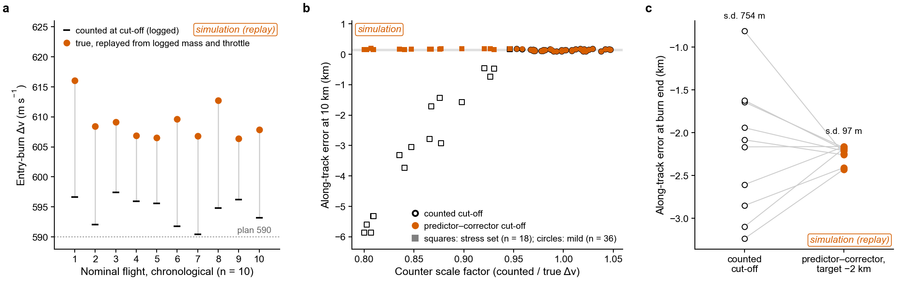

**Fig. 12 | Entry-burn termination in replay.** Counted and true Δv of ten nominal flights (a), along-track error in a Monte Carlo of counter errors for two cutoffs (b) and end-of-burn error under two targets (c).

In Fig. 12a the true Δv was 606–616 m s−1 against 590–597 m s−1 counted, an over-burn from cut-off latency. Fig. 12b plots the along-track error at 10 km against the ratio of counted to true Δv for the counted cutoff (open) and the P-C cutoff (filled). Circles are the mild set (scale 0.95–1.05 with up to three lost ticks, n = 36) and squares the stress set (scale 0.80–0.95, n = 18). With the counted cutoff the error ranged from +90 to +183 m in the mild set and reached −5.9 km in the stress set.

With the P-C cutoff it stayed between +90 and +187 m in all 54 draws. Fig. 12c shows the error at the end of the burn for the ten nominal flights under the counted cutoff and under a P-C cutoff targeting −2 km (s.d. 754 m and 97 m). The −2 km variant is a comparison configuration. The corridor configuration of this section ends the ten nominal burns on the same tick as the counted cutoff, with the same end-of-burn error.

### 5.3 Convex divert envelope

The envelope uses a minimum-landing-error, minimum-propellant convex planner (`powered_descent.py`) built on lossless convexification2, with the landing-error and fuel objectives as exact penalties4 and successive linearization5 of drag and Coriolis terms. It is written in CVXPY30,31 and solved with Clarabel32, and it is used offline only. The state is that of a flown ignition (16.5 t, 587.5 kN, *I*sp 289.6 s, drag area 25.4 m2), with thrust 10–100%, tilt ≤ 20°, a 10° glide-slope cone and free final time. The planner starts with no horizontal velocity at the flown descent speed for each height, and the largest offset is found by bisection to 10 m.

The planner nulls offsets from rest of up to 461 m when ignited at 500 m and 914 m when ignited at 2,000 m (Table 8, Fig. 10a). At a 500 m ignition it needs 878, 896, 1,053 and 1,250 kg of propellant for 0, 50, 150 and 300 m offsets. The envelope assumes a tilt of up to 20° without attitude dynamics, whereas the flights of Section 4.7 achieved 1–5° for commands of 9–19°.

The planner's propellant at zero offset (878 kg) is 24% below the flown zero-offset burn (1,148 kg; divert flight 0 used 1,179 kg). The flown burn includes a 0.65-throttle ignition test, a 0.12 throttle floor and lateral damping, which the optimal-control solution lacks. A law that uses such a margin, for example zero-effort-miss and zero-effort-velocity feedback24 as already used in the glide, is future work. The flights show that its first requirement is a clean hand-over to the terminal descent.

**Table 8 | Convex-planner envelope (simulation)**

| Ignition height (m) | 400 | 500 | 750 | 1,000 | 1,500 | 2,000 |
|---|---|---|---|---|---|---|
| Largest offset nulled from rest by the convex planner (m) | 359 | 461 | 625 | 734 | 875 | 914 |

| Offset from the pad at ignition (m) | 0 | 50 | 150 | 300 |
|---|---|---|---|---|
| Convex planner propellant, ignition at 500 m (kg) | 878 | 896 | 1,053 | 1,250 |

Thrust 10–100%, tilt ≤ 20°, glide-slope cone 10°, free final time.

## 6. How the AI agents were managed

This section describes how the human lead (H.H.) and the AI orchestrating agent (the orchestrator below) kept a fleet of AI sub-agents on course. It describes one project. The counting rules are in `paper/analysis/management_counts_build.py`, and the derived tables are committed with it.

### 6.1 Roles and verification

H.H. set the goals, owned each requirement by name, reviewed results and approved anything that needed his authority, such as the licence and the release. Technical, design, test and hardware decisions were left to the orchestrating agent, which reported results, reasons, risks and next steps to him. The orchestrator was a single long-running Claude Code session. It decomposed work, wrote briefs, decided and kept the records, and it passed large code changes and long debugging to sub-agents.

Sub-agents acted as responsible engineers for a subsystem, reviewers, red teams, mishap investigators, members of an andon panel and secretary. They did not talk to each other, and their reports came back to the orchestrator as inputs to be checked before adoption (Fig. 13). The session index holds 138 dispatches: 84 responsible-engineer tasks, 28 reviews, red teams or quality checks, 12 mishap or root-cause investigations, 3 andon-panel members, 8 secretary audits and 3 independent audits of project direction or process. Five were spawned by sub-agents, and the 138th drafted this section. Twenty-eight named a model at dispatch (24 Sonnet, 4 Opus) and 110 inherited the orchestrator's.

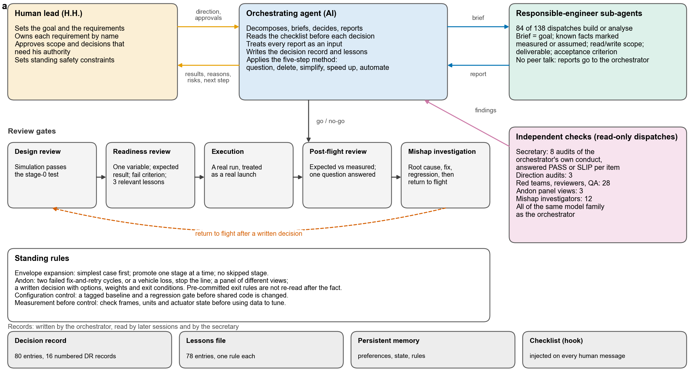

**Fig. 13 | The management loop.** Human lead, orchestrator and sub-agents, the five review gates, the independent checks, and the standing rules and records that carry the system between sessions.

In Fig. 13 direction and approvals go down and results, reasons and risks come back, and each sub-agent receives a brief and returns a report. Five review gates run in sequence with a return to flight after a written decision, and the independent checks are read-only dispatches.

Verification has three layers, and only the first is mechanical. The regeneration scripts reproduce every table and figure from the raw records, and a text test confirms that most quoted defaults appear in the code. Sentence-level audits of the numbers and citations by separate agent instances followed.

### 6.2 Briefs, review gates and standing rules

Every dispatch to a responsible engineer carried the goal, the known facts marked as measured or assumed, the files the agent may read and write, the deliverable and the acceptance criterion. The marking mattered because a hypothesis written into a brief tends to come back as a finding. Lesson 73 records an orchestrator guess, that a space station was rotating, which a reviewing agent disproved. A brief for an experiment named the one variable it tested, and before adopting a report the orchestrator checked where its data came from.

A new idea passed through five gates. A design review asked whether it passed in a simulator that had first reproduced flown trajectories. A readiness review, written into the experiment log before a flight, named the single question, the expected result, the failure criterion, a valid starting save, mains power and monitoring of every end state, and it listed the three most relevant lessons so that an old mistake would be looked for first. The flight was executed as if it were a real launch, and a post-flight data review compared expected with measured results. A crash or unexplained miss led to a mishap investigation, grounding of every vehicle of the same kind, a root cause, a corrective action, a regression test and a written return-to-flight decision. The record lists 16 gate events (Fig. 14) and 4 mishap investigations.

Four standing rules sat around the gates. Envelope expansion moved a new vehicle or control law through stages in order, from simulation to a static check, a flight from a 4 km checkpoint, a flight from 15 km, an entry with an aim offset and a return to the pad, and no stage could be skipped. The docking ladder R1-a to R1-d followed the same idea. The andon rule stopped the line after two consecutive failed fix-and-retry cycles of the same kind, at a vehicle loss or at a measurement error. It required a panel of different viewpoints and a written decision with options, criteria and weights fixed before scoring.

Configuration management meant a tagged baseline, per-vehicle saves and a regression gate before shared code changed (Section 4.5). Measurement before control required that frames, units and read-backs were checked before data tuned anything. Skipping it let an unremoved Coriolis term of about 0.76 m s−2 be read as aerodynamic lift and inflate the fitted lift coefficient by a factor of three to five (lesson 56).

Pre-committed exit rules were written before a flight and applied afterwards without re-reading them. The clearest case is law E (Section 4.7). The orchestrator chose a time-boxed option (O4) over three others, with its criteria and weights fixed first and an automatic fallback to freezing the flown law on two failures of the same kind, less than 0.7 t of propellant left, or one hour of game time. The first flight met the mission criterion and failed the law-intent criterion as written, and a proposal to re-read the criterion was rejected as a quiet relaxation. The second missed the mission criterion by 0.14 m and was classed as the same kind of failure, which triggered the fallback. The secretary later reviewed that classification, which was the orchestrator's judgement.

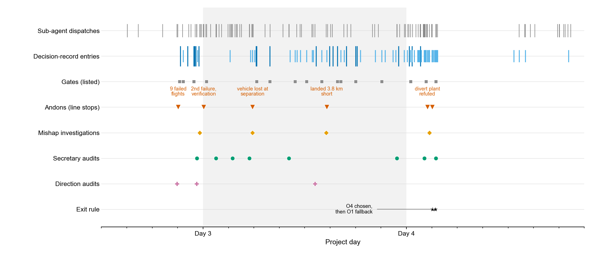

**Fig. 14 | Management events over the project.** Dispatches, decision-record entries, gates, andons, mishap investigations and audits.

Fig. 14 plots the 80 entries of the decision record, 20 of them headed with one of the 16 numbered decision records (DR-001 to DR-016), together with the 16 gates, the andons, the mishap investigations and the audits. The first andon, is the stop that followed nine failed flights and led to the written rule, so it is retrospective. The earlier part of the project preceded the decision record.

### 6.3 Independent checks

The secretary was a sub-agent that had taken no part in the work. Its fixed brief asked it to audit the orchestrator and not the engineering. It was read-only and could not run experiments, and it answered in about 400 words with PASS or SLIP for each checklist item and a quote or commit as evidence. The items covered decisions taken before their evidence, sub-agent claims adopted unchecked, work done itself instead of delegated, reports that outran the evidence, multi-variable experiments and drift from the goal. It ended with three corrections for the next hour.

The brief calls for an audit at every milestone or about every two hours. The session index holds 8 secretary dispatches, the decision record numbers six reviews (#1 to #6), and the intervals between dispatches ranged from 1.4 to 12.7 hours (median 2.3 h; four of seven within 2.3 h). Review #3 itself recorded that the cadence had slipped to 4.6 hours. Three independent audits of project direction or process fed DR-001, DR-006 and DR-009.

The 28 red-team and reviewer dispatches covered a trade study, the question whether a mishap was systematic, the framing of the report and reviews of the report. The orchestrator treated every verdict as a hypothesis, and two lessons record it approving a red-team argument before the evidence it had asked for arrived (59) and endorsing a decision with its own rough check (58).

### 6.4 Records, lessons and limits

Four records carried the system across sessions. The decision record holds 80 dated entries, 20 of them numbered decision records in the format question, options, criteria, evidence, decision, review criteria and outcome. The lessons file holds 78 entries (82 at a later audit) in the form symptom, root cause, rule. A short persistent memory index is loaded by every new session. A hook injected a fourteen-item checklist into every instruction from the human lead, so that questions about goal, evidence, one variable, delegation and reporting no more than the evidence supported were put before the orchestrator acted.

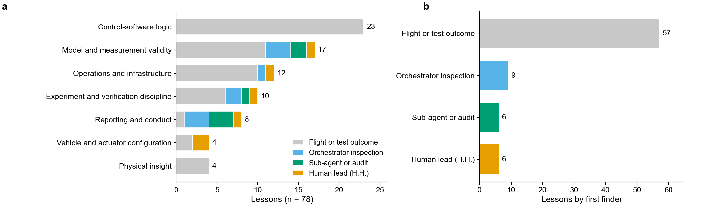

**Fig. 15 | The 78 lessons by category (a) and by who or what exposed the problem (b).**

By category (Fig. 15a) the lessons were mostly control-software logic (23), model and measurement validity (17), operations and infrastructure (12) and experiment and verification discipline (10), with reporting and conduct (8) and vehicle configuration and physical insight (4 each). By finder (Fig. 15b), 57 were exposed by a flight or test outcome, 9 by the orchestrator's own inspection, 6 by a sub-agent or audit and 6 by the human lead.

Five of the six entries found by the human lead record a question or reminder of H.H. that exposed a problem. They are grid fins mounted backwards, found when he asked why the fins were not visible (lesson 37), a continuously settable airbrake angle (46), a full launch flown where a saved game would do (52), a flight monitor that reported nothing for a finished flight (68), and work announced as started that had not been started (26). The sixth (49) records his intuition about tank-body drag, which the orchestrator then quantified.

Eight entries state that they repeat or vary an earlier lesson (a keyword count; a reading of the first 74 gives at least 8). One mistake of the same shape, flying a test from a save aimed with a wrong upstream value, recurred in lessons 45, 61 and 75.

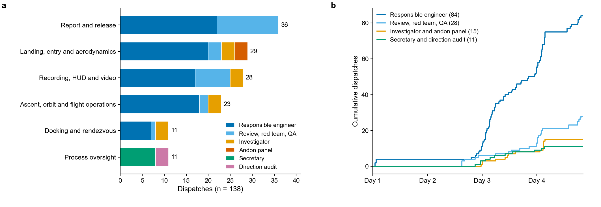

**Fig. 16 | Sub-agent dispatches.** The 138 dispatches of the orchestrating session by workstream and role (a) and cumulatively over time by role group (b).

Fig. 16 shows the six workstreams, the largest being report and release (36) and landing, entry and aerodynamics (29), and the growth of each role group over the four days.

The work stopped, when the report had converged.

### 6.5 Process defects found by the audits

The audits and reviews found four kinds of process defect. Reports ran ahead of evidence. Four of the six numbered secretary reviews (#1, #3, #5 and #6) record a statement to the human lead that was stronger than the evidence, and a fifth (#4) records a shipped video described as complete when it was not. "Main line protected" was retracted because the regression gate covers only the last 4 km. A simulated success rate of about 95% quoted one of two plant forms, while the other gave 29 to 35 of 40. "Cause found, vehicle fine" was said, 27 minutes before the pulse that discriminated between the two hypotheses. Timestamps were also guessed: headings carried clock times that did not match the commit record, and comparison with commit times gave the real ones (lesson 76).

A gate was skipped. R1-d attempt 2 started within about a minute of the report that explained attempt 1, with no written readiness review and without the three lessons. It crashed in a read path that had never run in the real game, and as the second consecutive failure it called the second andon (lesson 78). Earlier, a readiness text that promised one variable per matrix case was inaccurate (secretary #2), and an experiment changed several variables at once (DR-004). The stop rule was likewise not always followed, as the nine failed fins-only flights show (Section 4.2).

The orchestrator also did work itself that it should have delegated in two recorded cases (lessons 58 and 62). One was a rough integration written to check a sensitivity result, and the other a statistics script that reported five completed missions when none had flown.

## 7. Discussion and limitations

### 7.1 Discussion

The released code flies the whole mission from the pad to a pad landing. In the 28-mission series 26 landed within the criterion, with a median miss of 1.53 m that is a repeatable westward offset. The glide delivered the stage within about 2 m of the target at ignition, so the landing law never had to divert, and the same law gives 0.99 m, 1.53 m and 3.67 m from different start states. Divert has been flown once at 50 m with the frozen law (touchdown 2.1 m), twice with a second law, and in eight development burns whose closure of 19–111 m was set by software attitude limits.

Both development failures arose outside the phase that the regression gate exercises, and one had a visible precursor. A gate that starts 4 km above the pad does not exercise the entry burn, and its 5 m limit is 1.3 times the 3.7 m baseline. An open-loop termination criterion turns a bookkeeping error into a hand-off range error, and the mass-based count now flown removes the over-burn in replay. The two later stops share a pattern: a software path validated only against an offline copy. The divert simulator's copy of the ignition rule had drifted from the flight code, and the read path of the first thruster power-on, tested only against a simulated game connection, failed twice in the game before a read-only inspection step was added.

### 7.2 Limitations

The evidence is a development record. One vehicle family, one launch site, one host and one game build were flown, in a game with simplified aerodynamics, no wind and exact state knowledge unless navigation noise is applied, and the drag model was fitted on the same vehicle family. The series records the system as it developed (Section 4.1), and controlled divert was flown at one offset, 50 m. The fix for mission 21 has not flown under frame capture or loop stalls. No comparison with other autopilots has been made. The audits of the numbers and citations of this report were made by instances of the same model family as the author agent, directed from the same session, and the root causes of Table 6 and the counts of Section 6 were assigned by the AI agent whose work they describe (single coder). H.H. reviewed the experimental results and the video outputs and did not independently re-verify the numbers.

## 8. Conclusions and further work

### 8.1 Conclusions

kspilot is an open program that flies a launch vehicle in KSP from the pad to a commanded orbit, releases the payload, plans the deorbit burn and lands the core stage on the pad. In 28 development missions, 26 landed within the criterion, with a median miss of 1.53 m that is dominated by a fixed westward offset. The two failures were a booster collision at separation and an entry burn whose velocity-increment count missed ticks lost to loop stalls. Each led to a corrective change.

In the ablation flights, removing the airbrakes or the glide crashed every flight (two each), and a test flight with a 50 m offset landed 2.1 m from the pad. At large offsets eight uncontrolled burns closed 19–111 m. Early failures, among them vehicle designs without airbrakes, ascent-code losses and a stale drag calibration, led to a stop rule, a recalibration and a return to the proven vehicle.

Four management practices carried through the work: validating each simulator against flown data before trusting it (the divert simulator failed that test on its first flight), starting each new capability at the lowest-risk rung, as the docking extension did, writing exit rules before the flights that test them, and secretary audits, which caught several reports that ran ahead of the evidence.

### 8.2 Further work

A confirmatory campaign and a comparison with MechJeb2 and BoosterGuidance are planned.

## 9. Availability and reproducibility

The flight software, AutoLab plugin source, vehicle definitions, tests, analysis scripts and sanitised raw records are at https://github.com/howardhuang11-dotcom/kspilot. Code is released under the GNU General Public License v.3.0 or later (GPL-3.0-or-later). The text, figures and data of this report are released under CC BY-SA 4.0, and vehicle definitions derived from GPL-3.0 sources are distributed under the GNU General Public License v.3.0. These licences are share-alike, so modified versions must be released on the same terms.

The code in this repository is an export of the development tree. The revision hashes quoted in the tables refer to the development repository (17 distinct revisions for the 28 missions) and do not resolve here, and neither does the count of 385 commits. The code that flew each mission cannot be identified from this repository's history. The released tree is the code at the time of export, and the parameter statements of Section 3 refer to it. Some missions flew earlier revisions, for example a separation limit of 20 kPa before mission 13 and the Δv counter before mission 22.

The sanitised raw records needed to regenerate every table and figure are in `data/raw/` (47 MB, 610 files). They hold 325 supervisor transcripts, of which the 278 that started before the freeze enter the statistics, the descent telemetry of each flight, the experiment log, the robustness-matrix log, one rendezvous record, six simulation output files and 11 screenshots. Absolute paths of the authors' machine were replaced by relative ones, and Chinese-language status text in 81 transcripts was replaced by English equivalents without touching numbers.

Every table regenerated from the sanitised files is identical to the one from the original records. The transform, `tools/sanitize_logs.py`, changes 781 path strings and 1,001 lines with Chinese text in 298 of the 334 text and JSON files, and run on the private originals it reproduces all 610 files, the screenshots pixel for pixel. `data/raw/ORIGINAL_SHA256.txt` lists the SHA-256 of the 609 unsanitised originals, which stay private. The screenshots show in-game content that remains the property of its owners (`NOTICE`). Not released are the decision record, the lessons file, the contents of the per-flight text logs, the video and screen recordings, the two simulation tools and the predictor–corrector cutoff of Section 5.2. Tables 7 and 8 and Figs. 10a and 12 can be re-plotted from stored outputs and not re-run, because `tools/divert_envelope.py` and the simulators are among the unreleased tools.

`python paper/regenerate_all.py` verifies the raw files against the manifest, regenerates every number, table and figure, and stops with a readable message if files are missing. It was tested on a clean copy of the tree in a fresh Python 3.12 environment with no access to the development directories, and all tables and figures regenerate with the same content as the committed ones. KSP is not deterministic across sessions, so re-flown missions reproduce statistics and not individual values. The text test `tests/test_paper_parameters.py` checks most quoted defaults against the code, and `tests/test_entry_mc_counts.py` checks the Monte Carlo counts of Section 5.2 against this report. This report is typeset from `paper/kspilot_report.md` by `paper/latex/build_pdf.sh`, which requires pandoc 3.1 or later, tectonic and poppler.

## Acknowledgements

We thank the developers of kRPC; the authors of the Kerbal Reusability Expansion (EmbersArc and the TundraMods contributors); fratardi for the KSP_SCRIPTS vehicle designs; the MechJeb2 developers, whose open manoeuvre calculator was studied when the manoeuvre planner was re-derived (no MechJeb2 code is used); and Squad for Kerbal Space Program.

## Funding

No external funding.

## Author contributions

H.H. set the overall goals of the project and chose the methods and direction, including the docking concept in which the core stage docks itself. He reviewed the experimental results and the video outputs and is accountable for the content. Section 6.4 lists defects that he caught and the AI system had missed.

Claude (Anthropic; primarily Claude Opus 5.5, operated through Claude Code; subagents used the models and settings available in each session, and per-instance records were not kept) designed and implemented the flight software, simulators and analysis scripts, ran and supervised the flights, analysed the data and drafted this report. Claude is credited as an author to state how the work was done.

## Competing interests

H.H. declares no competing interests. Claude is a product of Anthropic, whose models were used throughout this work.

## Correspondence and supplementary material

Correspondence and requests for materials should be addressed to H.H. (howardhuang11@outlook.com). Supplementary information is in `paper/supplementary.md`.

## References

1. Blackmore, L. Autonomous precision landing of space rockets. In *Frontiers of Engineering: Reports on Leading-Edge Engineering from the 2016 Symposium* (National Academies Press, 2017).
2. Açıkmeşe, B. & Ploen, S. R. Convex programming approach to powered descent guidance for Mars landing. *J. Guid. Control Dyn.* **30**, 1353–1366 (2007).
3. Açıkmeşe, B., Carson, J. M. & Blackmore, L. Lossless convexification of nonconvex control bound and pointing constraints of the soft landing optimal control problem. *IEEE Trans. Control Syst. Technol.* **21**, 2104–2113 (2013).
4. Blackmore, L., Açıkmeşe, B. & Scharf, D. P. Minimum-landing-error powered-descent guidance for Mars landing using convex optimization. *J. Guid. Control Dyn.* **33**, 1161–1171 (2010).
5. Szmuk, M. & Açıkmeşe, B. Successive convexification for 6-DoF Mars rocket powered landing with free-final-time. In *2018 AIAA Guidance, Navigation, and Control Conference* AIAA 2018-0617 (AIAA, 2018).
6. Malyuta, D. et al. Convex optimization for trajectory generation: a tutorial on generating dynamically feasible trajectories reliably and efficiently. *IEEE Control Syst. Mag.* **42**, 40–113 (2022).
7. Dueri, D., Açıkmeşe, B., Scharf, D. P. & Harris, M. W. Customized real-time interior-point methods for onboard powered-descent guidance. *J. Guid. Control Dyn.* **40**, 197–212 (2017).
8. Simplício, P., Marcos, A. & Bennani, S. Guidance of reusable launchers: improving descent and landing performance. *J. Guid. Control Dyn.* **42**, 2206–2219 (2019).
9. Harpold, J. C. & Gavert, D. E. Space Shuttle entry guidance performance results. *J. Guid. Control Dyn.* **6**, 442–447 (1983).
10. Lu, P. Entry guidance: a unified method. *J. Guid. Control Dyn.* **37**, 713–728 (2014).
11. Putnam, Z. R. & Braun, R. D. Drag-modulation flight-control system options for planetary aerocapture. *J. Spacecr. Rockets* **51**, 139–150 (2014).
12. Squad. *Kerbal Space Program* v.1.12.5 (Private Division, 2023).
13. kRPC contributors. kRPC v.0.6.0. *GitHub* https://github.com/krpc/krpc (2026).
14. Allen, R. E. et al. SpaceGym: discrete and differential games in non-cooperative space operations. In *2023 IEEE Aerospace Conference* 1–12 (IEEE, 2023).
15. Rodriguez-Fernandez, V. et al. Language models are spacecraft operators. Preprint at https://arxiv.org/abs/2404.00413 (2024).
16. MuMech contributors. MechJeb2. *GitHub* https://github.com/MuMech/MechJeb2.
17. oyster-catcher. BoosterGuidance. *GitHub* https://github.com/oyster-catcher/BoosterGuidance.
18. Patrykz94. kOS-RTLS-Landing. *GitHub* https://github.com/Patrykz94/kOS-RTLS-Landing.
19. fratardi. KSP_SCRIPTS. *GitHub* https://github.com/fratardi/KSP_SCRIPTS.
20. EmbersArc & TundraMods contributors. Kerbal Reusability Expansion. *GitHub* https://github.com/TundraMods/Kerbal-Reusability-Expansion.
21. National Aeronautics and Space Administration. *NASA Systems Engineering Handbook* NASA/SP-2016-6105 Rev2 (NASA, 2016).
22. Dormand, J. R. & Prince, P. J. A family of embedded Runge–Kutta formulae. *J. Comput. Appl. Math.* **6**, 19–26 (1980).
23. Cherry, G. A general, explicit, optimizing guidance law for rocket-propelled spaceflight. AIAA Paper 64-638 (AIAA, 1964).
24. Guo, Y., Hawkins, M. & Wie, B. Applications of generalized zero-effort-miss/zero-effort-velocity feedback guidance algorithm. *J. Guid. Control Dyn.* **36**, 810–820 (2013).
25. Ebrahimi, B., Bahrami, M. & Roshanian, J. Optimal sliding-mode guidance with terminal velocity constraint for fixed-interval propulsive maneuvers. *Acta Astronaut.* **62**, 556–562 (2008).
26. Wilson, E. B. Probable inference, the law of succession, and statistical inference. *J. Am. Stat. Assoc.* **22**, 209–212 (1927).
27. Clopper, C. J. & Pearson, E. S. The use of confidence or fiducial limits illustrated in the case of the binomial. *Biometrika* **26**, 404–413 (1934).
28. Brown, L. D., Cai, T. T. & DasGupta, A. Interval estimation for a binomial proportion. *Stat. Sci.* **16**, 101–133 (2001).
29. Hunter, J. D. Matplotlib: a 2D graphics environment. *Comput. Sci. Eng.* **9**, 90–95 (2007).
30. Diamond, S. & Boyd, S. CVXPY: a Python-embedded modeling language for convex optimization. *J. Mach. Learn. Res.* **17**, 1–5 (2016).
31. Agrawal, A., Verschueren, R., Diamond, S. & Boyd, S. A rewriting system for convex optimization problems. *J. Control Decis.* **5**, 42–60 (2018).
32. Goulart, P. J. & Chen, Y. Clarabel: an interior-point solver for conic programs with quadratic objectives. Preprint at https://arxiv.org/abs/2405.12762 (2024).

## Appendix A. Glossary

| Term | Meaning |
|---|---|
| T-WorksFineGF family | The vehicle (four solid boosters around a liquid-fuelled core, Section 2.1) and its payload and ballast variants |
| Mission, flight, run, transcript | A mission is one complete flight from the pad (ascent, deorbit, return, landing). A flight is any flown run, including partial ones from a checkpoint. A run is one supervised execution, and a transcript is the supervisor's text log of a run |
| Checkpoint | A saved game state recorded during an earlier flight, from which a later phase is flown repeatedly (Section 2.3) |
| Regression gate | Three landings from the 4 km checkpoint after a code change (Section 2.3) |
| Line stop | Halting flights after two consecutive failures of the same kind or a vehicle loss (Table 6) |
| Miss | Horizontal distance of the centre of mass from the target after a 3 s hold and 10 s of settling |
| Touchdown offset | Distance of the contact point from the target at first ground contact (Section 4.1) |
| Law E | An alternative brake-then-translate divert law (Section 4.7) |
| EC | Electric charge, a dimensionless game unit |
| H.H. | The human author and lead |
| Orchestrating agent, orchestrator | The AI system (Claude) in its role of directing sub-agents |
| Sub-agent | A further instance of the same model family given a bounded task |
| Andon | A line stop that convenes a panel of different viewpoints before work resumes (Section 6.2) |
| Decision record, lessons file | The project's private logs of dated decisions and of numbered lessons (Section 6.4) |

## Appendix B. Transcript flow and population sensitivity

The development record holds 278 supervisor transcripts before the freeze (Table B1). Table B2 lists the ten population definitions behind Fig. 3.

**Table B1 | Flow of all development transcripts before the data freeze**

| Family | Starting point | Window | Success | Failure | Refused | Separation test | No outcome | Transcripts |
|---|---|---|---|---|---|---|---|---|
| T-WorksFineGF family | Pad | Before | 0 | 6 | 0 | 0 | 4 | 10 |
| T-WorksFineGF family | Pad | In | 26 | 2 | 1 | 5 | 2 | 36 |
| T-WorksFineGF family | Orbit checkpoint | Before / in | 2 / 0 | 2 / 0 | 0 / 0 | 0 / 0 | 3 / 1 | 7 / 1 |
| T-WorksFineGF family | Pre-entry checkpoint | Before / in | 8 / 4 | 7 / 0 | 0 / 0 | 0 / 0 | 1 / 0 | 16 / 4 |
| T-WorksFineGF family | 4 km checkpoint | Before / in | 47 / 25 | 13 / 0 | 0 / 0 | 0 / 0 | 2 / 0 | 62 / 25 |
| Variants without airbrakes | Pad | Before | 0 | 7 | 3 | 0 | 4 | 14 |
| Variants without airbrakes | Checkpoints | Before | 0 | 19 | 0 | 0 | 3 | 22 |
| T-WorksFinePayload (earlier vehicle) | All | Before | 24 | 37 | 0 | 0 | 20 | 81 |
| Total | | | 136 | 93 | 4 | 5 | 40 | 278 |

Window: started on or. Every transcript, with vehicle, starting point, outcome and inclusion status, is listed in `paper/tables/flow_all_transcripts.csv`.

The 36 in-window pad transcripts of the T-WorksFineGF family are the 28 analysed missions, 5 separation-only tests, 1 run terminated by an external monitor during the deorbit-node warp (cause from the decision record), 1 attempt refused before launch because recording failed and 1 attempt that crashed on a refused kRPC connection before launch (vehicle from the decision record). The pre-window pad failures include three ascent losses and two complete missions that missed by 189 m and 1,192 m.

**Table B2 | Sensitivity of the development success proportion to the population definition**

| Population | Successes / missions | % | Wilson 95% CI (%) | Clopper–Pearson 95% CI (%) |
|---|---|---|---|---|
| Development window, complete missions (headline population) | 26 / 28 | 92.9 | 77.4–98.0 | 76.5–99.1 |
| Return phase, conditional on reaching orbit | 26 / 27 | 96.3 | 81.7–99.3 | 81.0–99.9 |
| Window, monitor-terminated run counted as a failure | 26 / 29 | 89.7 | 73.6–96.4 | 72.6–97.8 |
| Window, also the two attempts that never launched | 26 / 31 | 83.9 | 67.4–92.9 | 66.3–94.5 |
| Window extended to the two preceding complete missions | 26 / 30 | 86.7 | 70.3–94.7 | 69.3–96.2 |
| All complete own-code-ascent pad missions of the family | 26 / 33 | 78.8 | 62.2–89.3 | 61.1–91.0 |
| The same, monitor-terminated run counted as a failure | 26 / 34 | 76.5 | 60.0–87.6 | 58.8–89.3 |
| Baseline configuration only | 16 / 17 | 94.1 | 73.0–99.0 | 71.3–99.9 |
| Without a recording workload | 19 / 20 | 95.0 | 76.4–99.1 | 75.1–99.9 |
| With a recording workload | 7 / 8 | 87.5 | 52.9–97.8 | 47.3–99.7 |

Jeffreys intervals are in `paper/tables/sensitivity.csv`.

The 26 of 33 population excludes a failed complete mission (miss 599.5 m, earlier ascent code), four pad runs of the family with no outcome (one a deorbit-planner crash), the earlier vehicle (24 of 81 transcripts successful) and the fins-only variants (0 of 14). The recording workload was in-game frame capture (missions 18–21), screen recording (22, 26 and 28) and an orphaned frame capture during the ascent of mission 7 (from the decision record). The baseline is the 2.48 t payload, a circular 100 km orbit and 6° inclination. Robustness-matrix cases are listed in Supplementary Table 1.

The file `stats.json` also holds proportions for three configuration epochs (missions 1–12, 13–21 and 22–28), split at the two failures; the last epoch is 7 of 7.
