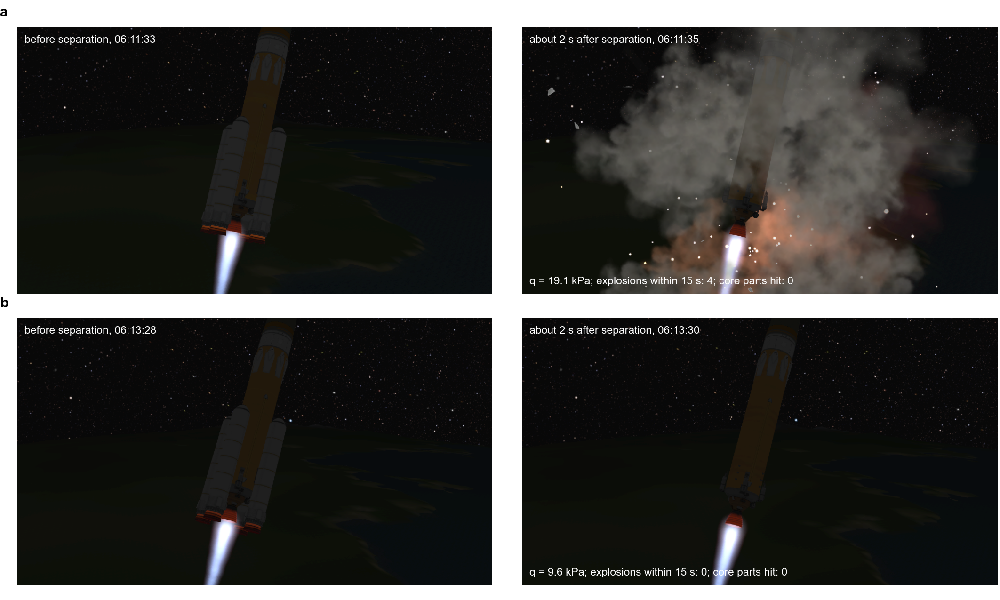
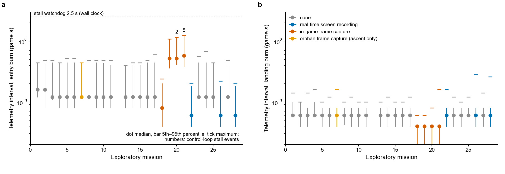
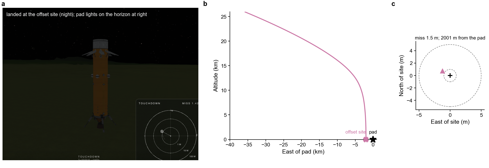
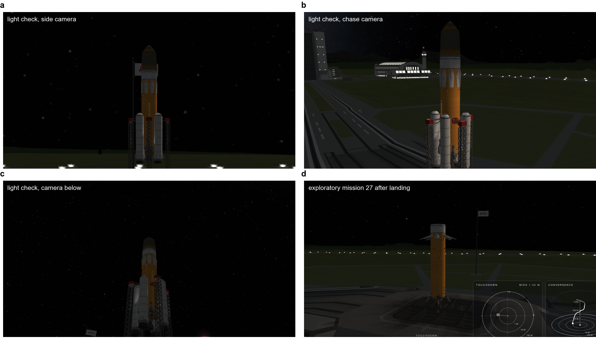
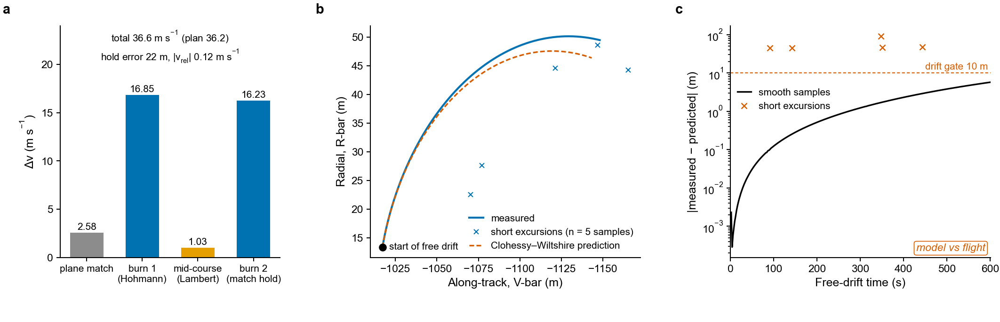

# Supplementary Information

**kspilot: an autonomous launch-and-booster-return controller for Kerbal Space Program: system and development report** (H. Huang & Claude). Supplementary information to `paper/kspilot_report.md`, version 2.3.

Contents: Supplementary Note 1 (development mishaps), Note 2 (electric power during long coasts), Note 3 (verification process), Note 4 (offset-aim mode), Note 5 (superseded divert simulation); Supplementary Tables 1–7 (Table 6: incident record; Table 7: docking-extension rungs); Supplementary Figs. 1–5 (separation frames, control-loop timing, offset-aim landing, lamp variant and rendezvous).

All development data in this document are exploratory (report, Section 4). Every value is printed by `python paper/analysis/compute_stats.py` (raw records in `data/raw`) unless it is marked as a decision-record estimate.

## Supplementary Note 1 | Development mishaps

**Booster collision at separation (mission 12, transcript `wd_20261021_054641`).** The first attempt of the 45° matrix case staged its four spent boosters 64.0 s after the transcript started, about 51 s after lift-off (the ascent began 13.1 s after the transcript started). Telemetry after staging showed 31 parts instead of the expected 37 and zero core thrust; the vehicle coasted to an apoapsis of about 21 km and the ascent aborted on reaching the surface about 183 s after lift-off. According to the investigation of the game's event log (decision record; the logs have since been overwritten and these values cannot be regenerated), the core's main tank exploded first and the engine and four legs separated with it, accounting for the six missing parts; the radial gap between boosters and core in the vehicle definition is about 0.17 m; and explosions involving boosters or nose cones occurred within about 2 s of separation in six of seven earlier separations at the then-current 20 kPa limit. The ascent did not control roll, and at this launch azimuth (41.7°) one booster lay close to the crossflow plane, a plausible but unproven aggravating factor.

Corrective actions: an abort on further part loss or thrust collapse after staging, a separation metric in the telemetry, and a separation limit of 10 kPa. A verification test flew the same azimuth to 15 s after separation (Supplementary Table 2): one of two tests at about 19 kPa produced four explosions within 3 s and none of three at about 9.6 kPa did; the core was intact in all five. These tests have no statistical power (Fisher's exact test, P = 0.4), and test A1 at 18.8 kPa had none. In the 16 later window missions that logged the metric, separation occurred at 9.4–9.9 kPa and the part count matched the expectation in all 16; a 15 s explosion window, measured in 8 of them, recorded booster-side explosions in 4 and core-side explosions in none. The windows of 3 s and 15 s are not comparable, so the effect of the lower limit is not demonstrated; the safety argument rests on the detection-and-abort barrier, which has not been exercised in flight and needs a forced-fault test.

**Velocity-increment accounting fault (mission 21, transcript `wd_20261021_135356`).** The mission was flown while in-game frame capture recorded video and slowed the game. The stage landed intact and upright at 0.31 m s−1, 3,776.49 m from the pad. The transcript records five dead-man events during the entry burn, logged as 2.9, 2.8, 0.1, 2.7 and 0.1 s (the logged value is the heartbeat age re-read after the throttle command completed; report, Section 3.4). The entry-burn Δv was then integrated as one thrust sample per control tick times the tick duration; with ticks of 0.5–1.2 s of game time, the sample after each stall read zero thrust and a whole tick of burning went uncounted. The logged mass falls from 20,313 kg before ignition to a settled 16,029 kg after shut-down: 4,284 kg of propellant, against 3,438–3,605 kg in the other missions, and a delivered Δv of 743 m s−1 (rocket equation, *I*sp 320 s) against 608 m s−1 counted and 590 m s−1 planned. Of the 135 m s−1 uncounted, 6–18 m s−1 is the cut-off latency seen on every flight; the rest, about 120 m s−1, is the stalled ticks, which matches the investigators' estimate in the decision record. A replay with the logged throttle reproduces the flown burn (743 m s−1; simulation). The along-track error at hand-off was −8.4 km. Drag modulation could not recover the shortfall.

Precursor: mission 20 (`wd_20261021_121138`, also with frame capture) logged two dead-man events in its entry burn (0.1 and 2.6 s) and still landed 1.53 m from the target with 604 m s−1 logged. The process did not act on it; the regression gate, which starts 4 km above the pad, could not see it. Corrective actions: Δv from measured mass (report, Section 3.4), a game-time stall detector for recording flights, and real-time screen recording instead of in-game frame capture. Verification: four flights from a checkpoint before the entry burn, two while recording, all passed (misses 1.23–1.74 m; 3,492–3,513 kg for 592–596 m s−1; no stall). The seven later window missions used a median of 3,496 kg (3,492–3,505 kg) and all passed. Root cause: the open-loop, counted-Δv termination of the entry burn (report, Section 5.2).

## Supplementary Note 2 | Electric power during long coasts

Inclined orbits pass near the launch site only every few revolutions, so the core may coast for hours. In a development flight from the orbit checkpoint (`wd_20261021_032851`, no outcome line) that waited for a daylight window, the deorbit burn did not execute; the saved game showed the core's 1,000-unit battery empty, which removed reaction-wheel and throttle authority. Power management now hibernates the probe core during time warp on coasts longer than 2 h, and every deorbit window must satisfy the charge budget (report, Section 3.2). In the exploratory window the planned wait had a median of 2.7 h (0.27–5.8 h); 19 missions hibernated for 58 segments (19 deorbit-window, 38 node and 1 entry-interface coast) and 245,138 s in total and used 31.1 units, a mean rate of 1.3 × 10−4 units s−1, 1.3% of the rate assumed in the budget (Fig. 8d). 

## Supplementary Note 3 | Verification process

Stage definitions are in Supplementary Table 3 and the gate sessions in Supplementary Table 4. Gate verdicts were cross-checked against the decision record. In one session, run during heavy parallel computation on the host, the misses were 2.18, 1.05 and 1.19 m; a single check without that load returned 3.67 m and the flight code was not changed. Two single checks are not gates. Development flights outside the window, including the grid-fin-only variants that never landed successfully in 24 descent-phase attempts, are summarized in `paper/tables/descent_records_by_vehicle.md`. The last complete mission before the window landed 1,192 m short because the per-vehicle drag tables were low against the drag measured in flight; after recalibration on three flights a replay of that mission predicted −1,220 m against the observed −1,192 m (decision record).

## Supplementary Note 4 | Offset-aim mode

An optional mode replaces the pad by a named, terrain-checked site, by default flat ground 2.0 km short of the pad on the approach track, so that a new configuration can make its first returns away from launch-site infrastructure. It is selected only by environment variables, and without them the code path is identical to the pad mission, which unit tests check. It was not used in any analysed flight and is not a test of divert capability, because the glide aims the stage at the offset site before ignition. Its first flight, after the data freeze, is shown in Supplementary Fig. 3.

## Supplementary Note 5 | Superseded divert simulation

A replay simulator of the landing burn (`tools/montecarlo.py`, since removed from the repository as stale, with the attitude plant identified from flown burns, Fig. 9) was built to analyse divert. An acceptance Monte Carlo of three lateral laws at 0–300 m offsets (n = 40 per bar) gave the following results:

| Offset from the pad at ignition (m), simulation | 0 | 50 | 150 | 300 |
|---|---|---|---|---|
| Flown law, nominal vehicle: within 5 m | 1 of 1 | 3 of 4 | 0 of 4 | 0 of 4 |
| Flown law, dispersed vehicles: within 5 m | 20 of 20 | 7 of 20 | 3 of 20 | 0 of 20 |
| Candidate lag-compensated law, nominal: within 5 m | 1 of 1 | 4 of 4 | 3 of 4 | 1 of 4 |
| Candidate lag-compensated law, dispersed: within 5 m | 20 of 20 | 8 of 20 | 6 of 20 | 1 of 20 |

**These results are superseded and are not evidence.** The first divert test flight (flown law, 50.0 m offset at ignition) lit the burn at 832 m and touched down 2.1 m from the pad; the simulator had predicted ignition at or below 492 m and median misses of 8.7 and 20.1 m in its two plant forms. Two defects were found. First, the simulator built the ignition rule from a hand copy of the flight parameters made 6.5 h before the flight rule gained a lateral-authority factor of 0.35 and a 3 s attitude dead time; with zero offset the two rules agree, so every nominal comparison had passed, and a test written to keep the simulator identical to its pre-revision state had pinned the stale copy. Second, the burn-phase body normal force had been taken from the glide, where the grid fins steer and the force acts with the tilt; identified from 47 gate burns it acts against the tilt (coefficient about −27 against +15). Each correction was tested against 136 flown landing burns with pass bands written before the run; the first fixed the ignition rule (136 of 136 ignitions on the logged row) but still over-closed above 60 m, and the second failed the held-out closure of the 50 m flight. The project stopped correcting the simulator after these two attempts. The divert claims of this report rest on the flight record only (Fig. 10b,c and Table 4). The convex-planner envelope (Fig. 10a) does not use this simulator.

## Supplementary Table 1 | Robustness matrix (exploratory)

| Case | Payload (t) | Orbit (km) | Inclination (°) | Deorbit threshold (m s−1) | Outcome | Miss (m) | Propellant left (kg) | Apoapsis/periapsis error (m) | Inclination error (°) | Deorbit Δv total/normal (m s−1) |
|---|---|---|---|---|---|---|---|---|---|---|
| 110 km orbit | 2.48 | 110 × 110 | 6 | 30 | Success | 1.45 | 4,078 | −1/−47 | +0.125 | 166/9 |
| Equatorial | 2.48 | 100 × 100 | 0 | 30 | Success | 1.56 | 4,167 | −11/−63 | +0.113 | 154/4 |
| 28° | 2.48 | 100 × 100 | 28 | 60 | Success | 1.25 | 3,989 | +4/−32 | +0.226 | 157/7 |
| 80 km orbit | 2.48 | 80 × 80 | 6 | 60 | Success | 1.89 | 4,322 | +84/−151 | −0.021 | 180/46 |
| 45°, attempt 1 | 2.48 | 100 × 100 | 45 | 100 | Failure (ascent) | – | – | – | – | – |
| 45°, attempt 2 | 2.48 | 100 × 100 | 45 | 100 | Success | 1.76 | 3,778 | −18/−51 | +0.356 | 155/5 |
| 4.50 t payload | 4.50 | 100 × 100 | 6 | 30 | Success | 1.22 | 3,100 | −9/−53 | +0.184 | 159/9 |
| Polar | 2.48 | 100 × 100 | 90 | 130 | Success | 2.27 | 3,244 | +6/−19 | +0.354 | 151/1 |
| 6.00 t payload | 6.00 | 100 × 100 | 6 | 30 | Success | 1.38 | 2,533 | −42/−103 | −0.030 | 158/9 |

Each row is one complete mission, flown in the order listed; matrix missions belong to the exploratory window and are not separate evidence. Four cases raised the deorbit-window threshold from its default of 30 m s−1. For the 28° and 80 km cases a replica of the planner showed that the default would have produced the same plan; for the 45° and polar cases this was predicted but not shown, so those two cases succeeded with case-specific tuning. Success in 8 of 9 attempts (Wilson 95% CI 56.5–98.0%; Clopper–Pearson 51.8–99.7%). Each case was flown once, so the matrix shows that a configuration can succeed, not how often. Power hibernation was active in every case except the equatorial one. Source: `paper/tables/matrix_cases.csv`.

## Supplementary Table 2 | Separation-only verification tests at a launch azimuth of 41.7°

| Test | Separation limit (kPa) | Dynamic pressure at separation (kPa) | Parts after separation | Core thrust (kN) | Explosions within 3 s | Core parts hit |
|---|---|---|---|---|---|---|
| A1 | 20 | 18.8 | 37 | 647 | 0 | 0 |
| A2 | 20 | 19.1 | 37 | 647 | 4 | 0 |
| B1 | 10 | 9.6 | 37 | 649 | 0 | 0 |
| B2 | 10 | 9.6 | 37 | 649 | 0 | 0 |
| B3 | 10 | 9.5 | 37 | 649 | 0 | 0 |

Each test ended 15 s after separation; 37 parts are expected after separation.

## Supplementary Table 3 | Envelope-expansion stages and promotion criteria

| Stage | Starting point | Purpose | Promotion criterion |
|---|---|---|---|
| 0, simulation | Replay simulator | Landing dispersion and propellant | Median miss < 20 m, 90th percentile < 100 m, no propellant exhaustion |
| 1, acceptance | Static checks | Parts, signs and drag tables | Agreement with the model |
| 2, low altitude | Checkpoint at about 4 km | Landing phase | At least 2 of 3 within 5 m |
| 3, mid altitude | Checkpoint at about 15 km | Glide and landing burn | At least 2 of 3 within 20 m |
| 4, entry with offset aim | Pre-entry checkpoint, target about 2 km from the pad | Predicted versus measured entry | Miss < 200 m |
| 5, return to launch site | Pre-entry checkpoint or orbit | Landing on the pad | Three consecutive landings within 20 m |
| 6, operations | Launch pad | Complete missions | Success-rate statistics |

Stage-0 results were used to rank and screen options and were not validated against flight dispersions; they are not reported as evidence.

## Supplementary Table 4 | Terminal-phase regression gates

| Session | Change under test | n | Miss (m) | Gate |
|---|---|---|---|---|
| 1 | Accumulated changes since the baseline tag | 3 | 3.59, 3.39, 3.66 | Pass |
| 2 | Removal of an unused control mode | 3 | 3.54, 3.86, 3.79 | Pass |
| 3 | Identification-mode code | 3 | 6.69, 3.77, 3.73 | Pass |
| 4 | Identification-mode revision | 3 | 3.94, 3.78, 3.70 | Pass |
| 5 | Off-pad touchdown logic | 3 | 3.84, 3.62, 3.57 | Pass |
| 6 | Airbrake settling and drag-table measurement | 3 | 3.71, 3.70, 3.45 | Pass |
| 7 | Recalibrated drag model | 3 | 3.68, 3.54, 3.58 | Pass |
| 8 | Overlay display and camera director | 3 | 4.02, 3.54, 3.57 | Pass |
| 9 | Performance and power management | 3 | 3.72, 3.58, 3.62 | Pass |
| 10 | Recording pipeline, version 2 | 3 | 3.95, 3.66, 3.66 | Pass |
| 11 | Recording pipeline, fix round 2 | 3 | 3.93, 3.67, 3.63 | Pass |
| 12 | Recording pipeline, fix round 3 (host under load) | 3 | 2.18, 1.05, 1.19 | Pass |
| 13 | Mass-based Δv accounting; recording pipeline, version 3 | 3 | 3.68, 3.71, 3.87 | Pass |
| 14 | Recording pipeline, round 6 | 3 | 3.96, 3.66, 3.73 | Pass |

Session record time is the experiment-log write time of the first landing; its run started 1–2 min earlier. Gate rule: at least two of three landings within 5 m and all three successful. All 44 checkpoint landings (14 sessions and two single checks): 43 within 5 m, median 3.67 m (IQR 3.58–3.77 m; range 1.05–6.69 m). The landings start from one saved state, so their spread measures software repeatability, not landing dispersion, and no binomial interval is given. Verbatim review labels and code revisions are in `paper/tables/regression_gates.md`.

## Supplementary Table 5 | Software configuration of the development flights

| Component | Version |
|---|---|
| Kerbal Space Program (macOS) | 1.12.5 |
| kRPC server and Python client | 0.6.0 |
| ModuleManager | 4.2.3 |
| Kerbal Reusability Expansion | 2.9.3 (Grid Fin M parts used) |
| Python (flight software) | 3.12.13 |
| NumPy, SciPy | 2.5.4, 1.18.1 |
| CVXPY, Clarabel | 1.9.3, 0.11.1 |
| protobuf | 7.36.2 |
| pytest | 9.1.1 |
| Python (analysis script; supports 3.9 or later) | 3.9.6 |

No other game modification was installed. Every descent-phase development record by vehicle and starting point is in `paper/tables/descent_records_by_vehicle.md`.

## Supplementary Table 6 | Incident record: mishaps and line stops

Descriptive record, coded by the agent whose work it describes (report, Sections 4.10 and 6). Line stop: flights halted under the rule to stop after two consecutive failures of the same kind, or after a vehicle loss.

| # | Event | Trigger | Root cause (as investigated) | Corrective action and outcome |
|---|---|---|---|---|
| 1 | Nine consecutive failed flights of a fins-only vehicle before a stop | Stop came after nine failures, not two | Repeated single-guess changes without a stop; vehicle without airbrakes | Return to the proven airbrake vehicle; the stop rule adopted as a standing process rule |
| 2 | Line stop: second consecutive failure of a verification block | Flight 173 m off at ignition, toppled | Drag tables about 7% low and a stale drag calibration; an off-pad thrust-cut rule caused the topples | Drag recalibration (start of the exploratory window) and a fix of the off-pad rule; two of these flights are in the divert flight record |
| 3 | Recording run from the orbit checkpoint did not execute its deorbit burn | Battery empty after a daylight wait | Unbudgeted electric-charge use on a long coast | Hibernation and an electric-charge budget in the window choice (Supplementary Note 2) |
| 4 | Mission 12: core lost at booster separation | Vehicle loss; automatic matrix stop | Booster–core collision at 20 kPa | Separation at 10 kPa, abort on part loss or thrust collapse, separation tests (Supplementary Note 1) |
| 5 | Mission 21: landed 3.8 km short | Grounding of the recording mode | Uncounted Δv during loop stalls; open-loop cutoff | Δv from measured mass; predictor–corrector cutoff proposed, not adopted (simulation only; the flown mass-based counter does as well in the replay) |
| 6 | Divert control flight contradicted the simulator | Pre-specified stop: "simulator wrong" | Simulator ignition rule drifted from the flight code; wrong sign of a force | Two corrected simulators failed pre-written acceptance; simulator dropped for claims (Supplementary Note 5) |
| 7 | Docking extension: two consecutive failures of the first thruster power-on | Automatic abort, then a crash in a new read path; nothing commanded | Summed thruster force read across inactive nozzles; remote thruster objects stale after a reload | Read-only in-game inspection step before any commanding step; third attempt passed |
| 8 | Alternative divert law failed twice in the same way | Pre-committed exit rule | Slow, high hand-over to the flown law, which drops to its throttle floor and drifts | Flown law frozen; alternative law is future work |

## Supplementary Table 7 | Docking-extension rungs R1-a to R1-d (exploratory, single flights)

Rungs flown after the data freeze, from the decision record; each rung had a written pass criterion before it was flown. No approach inside 1 km and no docking has been attempted.

| Rung | Content | Criterion (abridged) | Result |
|---|---|---|---|
| DOCK F1–F3 | Docking variant to a flat offset site 2,001 m from the pad, then twice to the pad | Landing criterion | Pass: 1.5 m from the offset aim point; pass: 1.3 m from the pad; pass: 1.2 m from the pad |
| R1 F1, F2 | Release of the cargo stack as the station in a 100 km orbit; chaser launch to an 80 km parking orbit | Near-circular orbit, relative inclination below 0.5°, no part loss | Chaser 80.01 × 79.76 km, 0.097°; station 100.3 × 100.2 km, 0.11° |
| R1-a | Read-only checks of the chaser (60 s) | Rotation channels off, thrust centre, docking-port axis, RPC latency, thruster force | All passed except the thruster force gate, which read zero because the RCS master switch was off (read-only artefact, verified in the craft file and the kRPC documentation) |
| R1-b | Main-engine rendezvous to a hold 1 km behind the station | Hold error at most 300 m, relative speed below 1.0 m s⁻¹, Δv at most 1.3 times plan | Pass: 22 m, 0.118 m s⁻¹, 36.6 m s⁻¹ against 36.2 m s⁻¹ planned (Supplementary Fig. 5) |
| R1-c | Read-only measurement at 1 km with both vessels loaded | Position noise at most 0.02 m, velocity noise at most 5 mm s⁻¹ | First run failed two criteria through reads straddling a physics tick (Supplementary Fig. 5c); criteria unchanged; after a read-path fix a 120 s smoke test gave 8 passes, 0 failures, 2 not applicable; the station was on rails, so the noise result is a numeric floor and target-attitude hold is unmeasured |
| R1-d | First power-on of the reaction-control thrusters | Polarity pulse 0.3–2 times the expected velocity change; relative speed below 0.1 m s⁻¹ | Attempt 1: automatic abort on a summed thruster force that counts inactive nozzles; attempt 2: crash in a new read path (stale remote objects after reload); attempt 3, after a read-only inspection step: pass, pulse 0.97 of expected with the correct sign, trim to 0.028 m s⁻¹, 1.10 propellant units used |

## Supplementary Figures

**Supplementary Fig. 1 | Booster separation in the verification tests.** In-game frames taken by the separation test immediately before and about 2 s after the release of the four spent boosters, at the launch azimuth of the lost 45° mission. **a**, Separation at 19.1 kPa: four explosions within 15 s, no core part hit. **b**, Separation at 9.6 kPa: no explosion. Of the five tests, one of two near 19 kPa and none of three near 9.6 kPa produced explosions, and the core was intact in all five. Frames are cropped around the vehicle and brightened uniformly (γ = 0.7); no other processing was applied.

**Supplementary Fig. 2 | Control-loop timing under recording workloads.** Game-time interval between successive descent-telemetry rows during the entry burn (**a**) and the landing burn (**b**) for the 27 exploratory missions with descent telemetry, by recording mode (dot, median; bar, 5th–95th percentile; tick, maximum). Without recording the entry-burn interval had a median of 0.12 s; in-game frame capture (missions 18–21) stretched it to about 0.5 s with maxima above 1 s, and the stall events of missions 20 (two) and 21 (five) occurred under it. Real-time screen recording, introduced as part of the corrective action, did not lengthen the interval. Dashed line, the 2.5 s wall-clock stall threshold that cut the throttle.

**Supplementary Fig. 3 | Offset-aim landing.** First flight of the docking variant after the data freeze, aimed at terrain-checked flat ground 2,000 m short of the pad on the approach track. **a**, The core after landing at night at the offset site (in-game image). **b**, Altitude against east distance from the pad for the final 40 km. **c**, Touchdown position relative to the site: miss 1.5 m, 2,001 m from the pad, touchdown speed 0.14 m s⁻¹. This single flight demonstrates the mode; it is not part of the exploratory statistics.

**Supplementary Fig. 4 | Lamp variant at night.** **a–c**, Pre-flight light check of the lamp variant on the pad from three cameras. **d**, The recovered core of exploratory mission 27 (lamp variant, miss 1.5 m) on the pad after a night landing. In-game images, cropped only.

**Supplementary Fig. 5 | Rendezvous to a 1 km hold (flight after the data freeze).** **a**, Manoeuvres flown by the chaser to reach a hold point 1 km behind the target on the along-track axis: plane match, Hohmann transfer, Lambert mid-course correction and velocity match; 36.6 m s⁻¹ used against 36.2 m s⁻¹ planned. The hold was reached 22 m from the aim point at 0.12 m s⁻¹ relative speed. **b**, The following 600 s free drift in the target's local-vertical local-horizontal frame, measured (299 samples, 2 s apart) and predicted by the Clohessy–Wiltshire equations from the initial relative state. **c**, Distance between measurement and prediction. The smooth samples diverge to 5.8 m after 600 s; five isolated samples (crosses) leave the trend along track and return to it at the next sample. Each departure is an integer multiple of 44.91 m, the distance the vessels travel in one 0.02 s physics tick (the target's orbital speed, 2,245.7 m s⁻¹, times 0.02 s): four of one tick (44.906–44.913 m) and one of two ticks (89.82 m), each within 0.02% of the multiple. This is the signature of a relative state assembled from position reads taken on different physics ticks. These samples set the logged maximum (90.9 m) that failed the 10 m drift gate.
